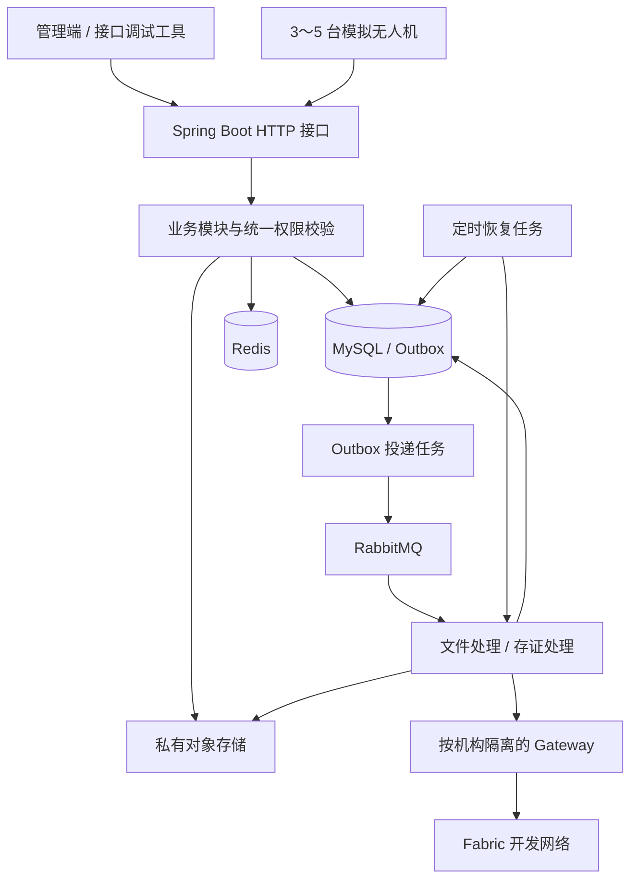
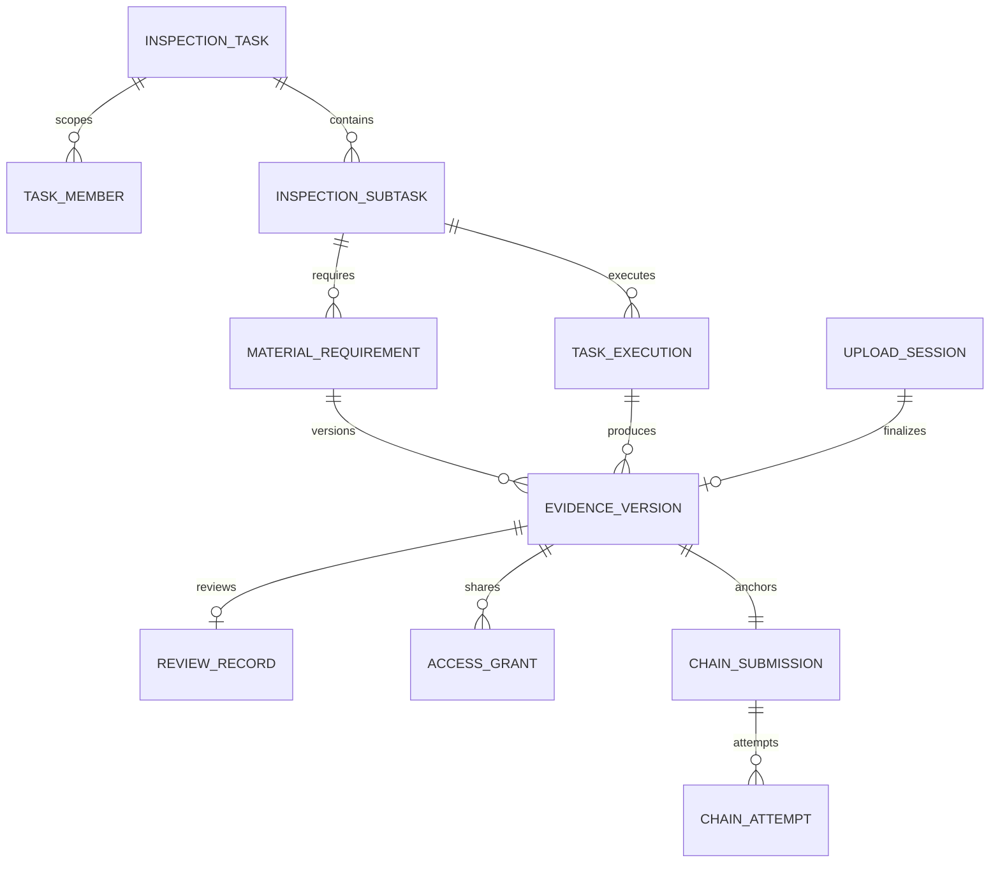

# 无人机集群巡检数据共享与证据溯源平台——技术设计

| 项目 | 内容 |
| --- | --- |
| 目标版本 | MVP（首版可演示版本） |
| 更新日期 | 2026-10-25 |
| 需求依据 | [01-requirements.md](01-requirements.md) |
| 架构 | Spring Boot 模块化单体，数据库作为业务状态的权威来源 |
| Fabric 范围 | 两个业务组织、一个通道、一份链码、两个业务操作 |

本文确定模块、数据模型、接口及关键处理规则，供后续建表和编码使用；除明确注明已实现或已验证的内容外，其余目录、模型和接口仍为实施设计。

## 1. 设计约束与技术选择

- Java 负责用户权限、任务、设备、文件、复核和共享；Fabric 仅登记和查询文件摘要。
- 文件在对象存储中保存，MySQL 保存业务记录，Redis 只保存可重建缓存。
- 同一工程包含 HTTP 接口、消息消费者和定时恢复任务，首版运行一个应用实例。
- 文件处理及链调用放在数据库事务之外；业务状态、待发送事件在本地事务中一起提交。
- 不引入微服务、分布式事务框架、MQTT、搜索引擎或额外工作流引擎。

| 项目 | 选型及约束 |
| --- | --- |
| 业务运行时 | JDK 21、Maven |
| Web 与认证 | Spring Boot 4.1.1、Spring Security 7.1.1；T008 使用 Nimbus HS256 JWT、BCrypt 及每请求数据库身份校验，由 Boot 管理版本 |
| 持久层 | MyBatis Spring Boot Starter 4.0.0、Flyway 12.4.0、MySQL Connector/J 9.7.0、MySQL 8.4.11；T007 空库迁移、重复初始化及真实约束验证已通过 |
| 缓存 | Redis，设备在线状态加速；不可作为唯一的业务持久化来源 |
| 文件 | Garage 2.4.1 私有桶；T010 使用 AWS SDK Java 2.56.0 的同步 S3 适配，路径式地址及可重读文件请求体 |
| 消息 | RabbitMQ 4.2.9、Spring AMQP 4.1.1（由 Boot 管理）；持久化消息、发布确认、mandatory 返回检查及手动 ACK |
| 区块链 | Fabric 2.5.16 开发网络（T004 已验证）；Java Gateway 双机构调用及文件检查点跨进程恢复在 T006 已验证 |
| Java 链接入 | JDK 21、Fabric Gateway 1.13.0、gRPC 1.84.0、Protobuf 4.36.2；2026-10-20 已通过真实网络调用 |
| 链码运行时 | JDK21、独立 Maven 模块、fabric-chaincode-shim 2.5.11；官方 ContractRouter CaaS 两组织各一实例，Peer 不挂载宿主 Docker socket |
| 环境 | Docker Compose；Fabric 网络沿用官方测试网络的组织及排序服务结构 |

Spring Boot 的 Java 要求及 MyBatis Starter 的主版本组合分别参照[官方系统要求](https://docs.spring.io/spring-boot/system-requirements.html)和[兼容表](https://mybatis.org/spring-boot-starter/mybatis-spring-boot-autoconfigure/)。工程初始化时先完成启动和连接验证，再锁定具体依赖及镜像版本，不使用浮动 latest 或 SNAPSHOT 作为复现基线。

Fabric 镜像和二进制工具使用同一发行版本，samples 固定对应版本或提交。链码在 chaincode/ 以 JDK21 独立构建包含依赖的 JAR，通过官方 ContractRouter 作为外部链码服务运行；两个组织使用同一份业务代码，各自配置对应的链码包 ID。

## 2. 系统结构



业务包建议如下，包之间通过 Service 调用，不通过 HTTP 相互访问：

```text
backend/
  common/          异常、响应、分页、时间和请求标识
  identity/        登录、用户、角色、任务范围校验
  inspection/      总任务、子任务、资料要求、执行批次
  device/          设备认证、心跳、进度和模拟事件去重
  evidence/        上传、文件版本、存储适配和核验
  review/          异常、人工复核
  sharing/         申请、审批、授权和下载凭证
  blockchain/      Gateway 适配、存证记录和交易尝试
  messaging/       Outbox、消费者、投递及恢复
  audit/           操作记录和核验记录
chaincode/         独立 Java 链码工程
simulator/         模拟设备程序
deploy/            开发环境配置与脚本
```

## 3. 身份、权限与数据归属

### 3.1 平台身份

- 用户登录使用用户名、密码和 BCrypt 密码摘要；返回 30 分钟有效的 Bearer JWT，首版不实现刷新令牌。
- JWT 保存用户标识和 tokenVersion，不接受客户端指定机构或角色。每次请求读取数据库中的账号状态、机构、角色和 tokenVersion，停用、退出或角色变更后可使旧令牌失效。
- 预置两个机构、必要测试用户和角色；机构管理员只能管理本机构用户及适用角色，不能直接获得全部任务资料权限。
- 角色代码固定为 ORG_ADMIN、OWNER_TASK_ADMIN、OWNER_REVIEWER、OWNER_DATA_APPROVER、OPERATOR_TASK_ADMIN、OPERATOR_USER。获授权访问是资源授权，不是额外全局角色。
- OrgA 可分配 ORG_ADMIN 和三个 OWNER_* 角色；OrgB 可分配 ORG_ADMIN、OPERATOR_TASK_ADMIN、OPERATOR_USER。数据库限制角色集合及机构白名单；T008 的角色修改接口在事务内锁定调用者与目标账号后重新校验权限、令牌版本及机构。

T008 使用 Spring Security Resource Server 与 Nimbus 实现 JWT。JWT_SECRET 必须是 64 位小写十六进制，解码为 32 字节 HS256 密钥；本地初始化脚本只生成一次，启动器读取原值。令牌除标准 iss/aud/iat/exp 外只保存 sub、tokenVersion，不保存密码、机构或角色。签发固定 issuer=uav-inspection、audience=uav-inspection-api、typ=JWT，有效期 30 分钟；校验锁定 HS256，拒绝缺失声明、非整数或负版本、未来签发时间及超过 30 分钟的有效期，时钟偏差容忍为 0，到期时刻立即失效。

登录只接受 username/password，错误密码、不存在或停用账号统一 401；密码按 UTF-8 字节限制为 72，超过限制返回 400。角色请求只接受 roles/expectedLockVersion；未知字段、空/重复/未知角色或机构不适用角色返回 400。无管理员权限、跨机构或不可管理目标统一 403，版本冲突返回 409。更新成功同时递增目标账号 token_version 和 lock_version；角色与权限始终以数据库当前值为准。退出仅按本次请求的原 tokenVersion 条件更新，递增两个版本，使该版本的所有令牌失效；延迟退出不会撤销后来签发的新版本令牌。

认证过滤器与业务控制器都使用统一错误结构及 traceId。账号数据库不可用返回 503 并拒绝业务访问；401 携带固定 WWW-Authenticate: Bearer，不回传 JWT 校验原文。未启用 database 的独立 HTTP/Gateway 模式只提供基础能力，业务控制器不注册；启用 database 后除状态与登录入口外请求均需认证。T009 接入任务成员权限，文件版本及核验随后接入任务路径，T020 补齐指定版本的共享授权路径。

### 3.2 两条资源访问路径

1. **任务路径**：账号有效，机构是任务委托方或执行方，用户是该任务成员，并具备本次操作所需角色。
2. **共享路径**：账号有效，存在面向该用户、该文件版本、当前时间有效且未撤销的授权；只开放指定版本的查看、下载和核验，不开放整个任务及其他版本。

统一 ResourcePermissionService 执行以上判断。列表查询在 SQL 中按任务成员或授权过滤，分页前完成过滤；详情、预览、下载、核验再次检查同一规则。

T009 已实现任务路径：创建者必须为 OrgA 的 OWNER_TASK_ADMIN；读任务需有本机构适用业务角色和显式成员关系，ORG_ADMIN 单独不能读取任务。修改前锁定任务、重读并锁定当前账号，重新校验 enabled、tokenVersion、机构、业务角色和成员关系。数据库事务使用 READ_COMMITTED，MyBatis 使用 STATEMENT 缓存范围，锁等待后的权限重读不复用旧快照或旧缓存。无权限和不存在的任务/子任务统一返回 403；有业务角色但没有成员关系的用户任务列表为空，ORG_ADMIN-only 任务列表返回 403。T020 接入指定版本的共享路径，不改变任务接口的成员要求。

创建任务时将创建人加入任务成员。委托方管理员指派本机构复核、审批成员，通过任务分配操作加入运营商任务管理员；运营商管理员可指派本机构操作人员，不能添加委托方成员或更改委托方验收要求。成员维护接口只替换调用者有权管理的本机构成员，必须保留其他机构成员和任务创建人，不能将 userIds 解释为整个任务的全量成员替换。

共享申请通过已知版本编号提交，不提供全平台证据搜索。未获授权者提交申请不会获得文件详情；对无效编号或不可申请资源返回统一错误，避免泄露任务信息。

### 3.3 设备身份

设备使用独立的随机设备令牌，数据库仅保存其摘要；设备标识与令牌一并校验。设备接口不接受用户 JWT 充当设备身份，也不允许设备调用复核、共享或用户管理接口。

每次模拟器启动生成 bootId，上报包含 eventId、seq、executionId。服务端以接收时间计算在线状态，以设备身份和执行批次校验上报范围。

T015 使用独立设备 SecurityFilterChain，设备接口位于 `/api/v1/device/**`，同时校验 `X-Device-Id`（规范小写 UUID）和 `X-Device-Token`（32 字节随机值的 64 位小写十六进制编码）。用户 JWT 不能代替设备凭据；用户接口仍只接受用户 JWT。每次设备请求读取当前数据库启用状态并常量时间比较令牌摘要，写事务取得设备行锁后再次校验原凭据，禁用设备后原令牌立即不可用。设备身份不能访问用户、角色、版本查询、核验、复核和共享接口。

运营商 `OPERATOR_TASK_ADMIN` 可登记、分页查看和启停本机构设备，`ORG_ADMIN` 单独不具备设备管理权限。登记只接受 code，机构、编号、令牌由服务端生成；首次响应包含 device 和 deviceToken，后续读取不返回令牌或摘要。启停使用 expectedLockVersion，变更与 USER 审计同事务；心跳也递增设备版本，管理员提交前应使用最新版本。

`POST /api/v1/device/reports` 接收 bootId、seq、eventId、executionId、type、progress。type 仅 HEARTBEAT/PROGRESS；前者 progress 必须为空，后者为 0～100 整数。seq 为 0～9007199254740991 的整数，避免客户端 JSON 整数精度丢失。服务端依次锁定任务、子任务、执行批次和设备，检查机构及该批次分配设备。新报告要求任务为 RUNNING/WAITING_ACCEPTANCE，执行为当前 RUNNING 或原非当前 CLOSED 批次；后者只记录历史事件和原设备在线时间，不改变任何执行进度。READY、不一致批次及已完成任务拒绝新报告。

V8 追加 device_event，唯一 `(drone_id, boot_id, seq)` 和 `(drone_id, event_id)`，并通过 `(execution_id, drone_id)` 复合外键固定设备批次归属。事件保存完整请求指纹、数据库 UTC received_at 和当时 applied_progress；同键同请求返回原 id、receivedAt、executionProgress，并标记 duplicate=true，不再次刷新心跳、增加进度或写成功审计。同键不同内容返回 409 IDEMPOTENCY_CONFLICT。不同序号乱序到达时只将进度取最大值，新 bootId 可以从 seq=0 开始，事件历史仍保留。上报进度达到 100% 不改变任务状态或成果验收结论。

成功新事件、最近接收时间、执行进度和 DEVICE 审计在同一事务提交。默认连续 20 秒没有新报告为离线，恰好到达阈值时已离线；不采信设备提供的采集时间。提交后才尽力写入带 TTL 的 Redis 毫秒时间缓存，Lua 取最大值避免延迟旧写覆盖新值。设备详情仍读取数据库身份和元数据，缓存缺失、异常、过旧或无对应数据库事实时用数据库接收时间并尝试重建，不让缓存制造在线状态；Redis 失败不回滚已提交事件。

设备上传通过 `/api/v1/device/upload-sessions` 提供与操作员相同的会话创建、进度、单片及完成能力，凭据及会话所有者均为设备。复用文件处理和 Outbox，事务检查原执行所属设备，I/O 后重新校验设备启用状态，固定版本保存 uploader_drone_id；不会将设备伪装为用户或授予用户业务角色。完成接口仍要求 messaging profile。T016 允许原设备向非当前 CLOSED 批次补传，资料始终固定在原批次；新设备无权取得旧设备会话，重复报告仍返回原受理快照且不刷新在线时间。

### 3.4 Fabric 身份

| 业务机构 | 样例网络映射 | 应用能力 |
| --- | --- | --- |
| OrgA 委托方 | Org1MSP | 查询摘要 |
| OrgB 运营商 | Org2MSP | 登记和查询摘要 |

Gateway 按机构配置并复用连接，机构证书和私钥分别挂载。服务端先执行平台权限校验，再选择该用户所属机构的查询身份；后台自动登记统一使用 OrgB 身份。用户不能通过请求参数切换机构身份。

本地演示服务持有两个应用身份，属于开发部署的信任边界；不能据此声称两个机构已实现生产环境的运维隔离。平台个人操作写审计日志，链上体现机构应用提交。

## 4. 数据模型

### 4.1 通用约定

- 业务主键使用服务端生成的 UUID 字符串；证据编号独立于文件名和对象路径。
- MySQL 使用 InnoDB、utf8mb4；时间以 UTC 写入 DATETIME(3)，接口使用带 Z 的 ISO 8601，界面按 Asia/Shanghai 显示。
- database 配置固定连接时区为 +00:00，并将其应用到 MySQL 会话；Hikari 使用 READ COMMITTED。UtcInstantTypeHandler 为 Instant 的 JDBC 读写显式传入独立 UTC Calendar，避免依赖 JVM 默认时区；DATETIME 本身不携带时区。
- SHA-256 使用 64 位小写十六进制字符串；文件长度用 BIGINT，业务版本号用正整数。
- 可变业务行包含 lock_version，用于条件更新；它与文件 version_no 含义不同。
- 外键及唯一约束在迁移脚本中定义，历史业务不级联删除；文件路径、对象键只由后端生成。
- 单项资料对应一个稳定证据编号。需要三张不同照片时配置三个资料项；同一资料项再次提交代表新版本，避免把补拍资料混成同一批文件。

### 4.2 用户与任务表

| 表 | 关键字段 | 约束或用途 |
| --- | --- | --- |
| organization | id、code、name、msp_id | code、msp_id 唯一，预置 OrgA/OrgB |
| app_user | id、org_id、username、password_hash、roles、enabled、token_version、lock_version | username 全局唯一且大小写敏感；roles 为固定枚举数组，不能自行创建角色 |
| inspection_task | id、owner_org_id、operator_org_id、name、scope、status、created_by、lock_version、completed_at | owner 固定为 OrgA，operator 固定为 OrgB |
| task_member | task_id、user_id | 联合唯一；业务层检查机构及角色 |
| inspection_subtask | id、task_id、name、current_execution_id、lock_version | 首次分配前 current_execution_id 可空，分配后指向本子任务当前批次 |
| material_requirement | id、evidence_id、task_id、subtask_id、name、required、next_version_no | evidence_id 唯一；启动前 subtask_id 可空，启动时必须绑定同任务子任务；next_version_no 在定版事务中递增 |
| drone | id、operator_org_id、code、token_hash、enabled、last_seen_at、lock_version | code 唯一；归属 OrgB |
| task_execution | id、subtask_id、drone_id、status、started_at、closed_at、progress | 批次不可复用；状态 READY/RUNNING/CLOSED |
| execution_adjustment | id、task_id、subtask_id、previous_execution_id、new_execution_id、actor_id、reason、created_at | 每次换机保留原批次、新批次、操作者及原因；前后批次必须属于同一子任务 |
| device_event | id、drone_id、boot_id、seq、execution_id、event_type、received_at | 唯一 (drone_id, boot_id, seq)，防止重复计数 |

委托方创建草稿任务及必交要求；运营商在已分配阶段拆分子任务并绑定资料项。必交项的内容由委托方维护，运营商不能删除或降低要求。开始执行前检查所有资料项已绑定子任务，之后冻结资料要求，首版不提供执行中修改验收清单的流程。

#### 4.2.1 T007 首版迁移边界

`V1__identity_and_task_scope.sql` 仅建立 organization、app_user、inspection_task、task_member、drone 五张表。T007 已于 2026-10-21 完成真实 MySQL 验证；V1 已应用，后续增加表或调整 DDL 必须追加新版本迁移，不回改 V1 或已有校验和。

- 主键和外键 UUID 字段采用 CHAR(36)、ascii_bin；表默认 utf8mb4_0900_ai_ci。OrgA/OrgB 的公开固定编号分别为 `00000000-0000-4000-8000-000000000001`、`00000000-0000-4000-8000-000000000002`。迁移建立这两条基础机构记录，CHECK 固定编号、code 与 MSP 的映射，code 和 msp_id 分别唯一。
- username 使用 utf8mb4_0900_as_cs，全局唯一且区分大小写。password_hash 只接受长度 60 的 BCrypt 格式；演示初始化使用 cost=12，不保存明文密码。roles 使用非空 JSON 字符串数组，JSON_SCHEMA_VALID 限定六个固定枚举并禁止重复，JSON_CONTAINS 配合固定机构编号限制各机构角色白名单。
- inspection_task 的 owner 固定 OrgA、operator 固定 OrgB，默认 DRAFT；数据库限定五种任务状态，并要求仅 COMPLETED 具有 completed_at。`(created_by, owner_org_id)` 复合外键引用 app_user 的 `(id, org_id)`，保证创建人属于委托方；任务操作权限和状态流转由 T009 等后续服务实现。
- task_member 使用 `(task_id, user_id)` 联合主键，补充 `(user_id, task_id)` 反向索引；用户机构、任务机构/状态及设备机构/启用状态有相应索引。外键均采用 RESTRICT，不级联删除历史引用。
- drone 固定归属 OrgB，code 唯一，token_hash 限定 64 位小写十六进制。enabled 限定 0/1；用户、任务和设备的 lock_version 及用户 token_version 均非负。时间字段采用 DATETIME(3)，可变记录包含创建及更新时间。

首版迁移不插入账号、设备、任务或任务成员。演示账号和首条链路所需设备由第 10 节的显式初始化提供，不提前实现登录、角色管理、任务流转或设备业务接口。

本轮采用三个独立进程执行 migrate、seed、verify，报告位于 `.local/database-probe/20261021T020400Z-0600c978/`。迁移阶段为两个机构、零用户、零设备；演示初始化后为六个用户、一台设备，任务及成员始终为空。重复启动后 Flyway 仍只有一条成功 V1 记录，迁移校验和、原始凭据文件及五表完整快照均保持一致；seed/verify 的快照 SHA-256 为 `d870185664ccb78f71abaace3865d50ce6b9941190a7fce7fa798b0f1b5fabec`。

verify 已实际验证 24 项唯一键、角色及机构白名单、外键、摘要格式和版本约束；探针写入全部回滚。在 JVM 时区 Asia/Shanghai 下，`2026-10-21T00:00:00.123Z` 经 UTC handler 写入并读回完全一致，SQL NULL 也保留；实际连接会话为 +00:00 和 READ-COMMITTED。后端原有 32 项常规测试回归通过。这些结果证明迁移、初始化和持久层边界，未将后续认证、任务或设备 HTTP 功能计为已完成。

#### 4.2.2 T008 身份审计迁移

T008 追加 `V2__identity_audit.sql` 建立 audit_log，保留已应用的 V1 及其 checksum=-539134757。审计记录包含操作者、机构、动作、资源编号、traceId、结果及 UTC 时间；actor_id/resource_id 为多态编号，不建立到 app_user 的外键，org_id 保留机构外键。写入 Mapper 只暴露 INSERT，T021 通过独立只读 Mapper 提供按任务查询，不提供更新或删除审计的接口。

登录成功、实际生效的退出及角色修改分别记录 AUTH_LOGIN、AUTH_LOGOUT、USER_ROLES_CHANGED。角色更新和退出的审计与版本更新处于同一数据库事务，失败回滚不会留下成功审计。只记录安全元数据，不保存密码、BCrypt 摘要、JWT、请求正文或完整响应。应用日志关闭认证请求和响应的 HTTP 诊断输出；数据库异常仅记录类型。该设计不声称数据库管理员无法修改审计记录。

#### 4.2.3 T009 任务、资料项及初始批次

T009 追加 `V3__task_execution_scope.sql` 建立 inspection_subtask、material_requirement、task_execution，保留 V1/V2。资料项的 `(subtask_id, task_id)` 复合外键保证子任务属于同一任务；子任务的 `(current_execution_id, id)` 复合外键保证当前批次属于自身。执行表生成列 active_subtask_id 仅对 READY/RUNNING 取子任务编号，唯一约束限制每个子任务最多一个活跃批次，CLOSED 历史可保留多条。批次状态、开始/关闭时间、0～100 进度和正版本号由 CHECK 约束，历史关联使用 RESTRICT。

任务创建可先保存空资料清单的 DRAFT，并自动添加创建人为成员。委托方在 DRAFT/ASSIGNED 阶段整批维护资料要求：已有项携带 id，保留 evidenceId 和绑定；新项不传 id，由服务生成两个独立 UUID；未绑定项可移除，删除已绑定项返回 409。运营商只绑定资料项，不能修改其内容或必交属性。每次维护递增任务版本，已有项同时递增自身版本。

分配运营商时，委托方任务成员中的 OWNER_TASK_ADMIN 校验 OrgB 及已启用的 OPERATOR_TASK_ADMIN，加入该管理员并将 DRAFT 改为 ASSIGNED。成员维护只替换调用者本机构的适用业务角色成员，拒绝跨机构、停用或无适用角色目标；省略创建人仍保留，另一机构成员不受影响。运营商管理员需已是任务成员，才能细化子任务、分配设备或启动任务。

任务及子任务的关键写入使用 expectedLockVersion；分配设备使用子任务版本，其他写入使用任务版本。子任务创建、成员/要求变更、初次分配设备和启动均递增任务版本；初次设备分配还递增子任务版本。第一次分配只在 ASSIGNED 阶段建立 READY 批次，已有当前批次时返回 409。启动先锁任务、子任务、资料项和批次，再按设备编号去重排序获取行锁并重查启用状态，最后将原 READY 批次改为 RUNNING 并设置同一个 UTC startedAt，不创建新编号；任务、子任务和执行版本递增。

任务及子任务路径编号、成员/运营商管理员/设备/资料编号使用规范的小写 UUID；格式不合法返回 400，合法但无权限或不存在的任务资源仍统一返回 403。创建请求不接受客户端提供机构、创建者、状态、资料证据编号或批次编号。

七种成功写入分别记录 TASK_CREATED、TASK_REQUIREMENTS_UPDATED、TASK_ASSIGNED、TASK_MEMBERS_UPDATED、SUBTASK_CREATED、EXECUTION_CREATED、TASK_STARTED，与业务变更同事务。T009 仅实现到 RUNNING，换机、进度、上传及任务验收仍在后续任务；不将任务启动计为成果完成。

### 4.3 文件、复核与共享表

| 表 | 关键字段 | 约束或用途 |
| --- | --- | --- |
| upload_session | id、task_id、subtask_id、requirement_id、evidence_id、execution_id、actor_type、actor_id、client_request_id、request_hash、filename、content_type、expected_size、part_size、part_count、status、expires_at、lease_token、lease_until、retry_count、next_action_at、last_error、lock_version | 唯一 (actor_type, actor_id, client_request_id)，相同请求内容才可复用 |
| upload_part | session_id、part_no、size、sha256、object_key | 唯一 (session_id, part_no)，一个分片只接纳一种内容 |
| evidence_version | id、requirement_id、evidence_id、version_no、execution_id、upload_session_id、uploader_user_id、uploader_drone_id、submitter_org_id、object_key、size、sha256、review_status、created_at | 唯一 (evidence_id, version_no)、upload_session_id；出生即为校验完成的固定版本 |
| issue | id、task_id、evidence_version_id、description、created_by、created_at | 描述 1～4000 字；版本与任务复合外键；同一版本可有多条异常，不修改原文件 |
| review_record | id、evidence_version_id、decision、reason、reviewer_id、created_at | evidence_version_id 唯一；一版只形成一次正式复核结论；退回原因必填，最多 1000 字 |
| access_grant | id、version_id、applicant_id、client_request_id、request_hash、status、reason、requested_valid_until、approver_id、decision_reason、decided_at、valid_until、revoked_by、revoke_reason、revoked_at、lock_version、created_at、updated_at | 唯一 (applicant_id, client_request_id)；同键不同请求拒绝；一条记录承载申请与获批授权，保留决定和撤销事实 |
| verification_record | id、version_id、user_id、source、actual_sha256、ledger_sha256、actual_size、ledger_tx_id、result、reason、verified_at | source 为 STORED/COPY；副本不产生证据版本 |
| audit_log | id、actor_type、actor_id、org_id、action、resource_type、resource_id、trace_id、result、created_at | 追加记录，不记录密码、令牌、私钥或完整下载地址 |

文件处理状态由 upload_session 表示；evidence_version 只保存已经就绪的版本，后文 READY 指这一就绪语义，不重复保存处理状态。review_status 初始为 PENDING；原始文件摘要、对象键和版本号不再修改。

当前验收版本采用数据库查询，首版不增加“最新版本指针”表：按资料项与子任务 current_execution_id 过滤，取最大 version_no。版本号按定版成功顺序分配，不使用设备时间或上传开始时间排序。

#### 4.3.1 T010 上传会话与私有分片边界

T010 追加 V4__upload_sessions_and_versions.sql 建立 upload_session、upload_part、evidence_version，保留 V1～V3。会话固定资料项、证据编号、任务/子任务与执行批次，复合外键限制关联属于同一范围；分片以 (session_id, part_no) 为主键，object_key 全局唯一。evidence_version 仅预建结构，T010 不插入正式文件版本。会话分片几何、摘要格式、租约字段成对及到期时间等由数据库约束，分片实际长度与所属会话规格由事务内服务检查。

上传 API 同时启用 database、storage profiles。启动器读取既有 S3_*、UPLOAD_* 参数；database-only 的认证、任务及数据库探针保持独立。S3 使用静态凭据、显式 endpoint/region、路径式访问，不调用建桶或公开 ACL。Garage 配置禁用 SDK 分块编码，校验和策略为 WHEN_REQUIRED，业务 SHA-256 独立计算，不把 ETag 当作文件摘要。允许类型、文件上限、分片大小、24 小时会话期及私有临时目录可配置；分片至少 8 字节、会话期最多 7 天，最大文件对应分片数不超过 10000。

用户上传要求 OrgB、OPERATOR_USER、显式任务成员及会话所有者同时成立，OPERATOR_TASK_ADMIN 单独不能代替操作员权限。任务为 RUNNING/WAITING_ACCEPTANCE 时，接受当前 RUNNING 批次上传；T016 也允许当前仍具权限的操作员向原非当前 CLOSED 批次补传历史资料。设备路径另要求原分配设备及设备会话所有权。完成任务禁止写入。GET 及同请求重试仍检查当前身份、任务权限和所有者，可以查看过期/冻结会话；同键不延长原 expiresAt。

创建请求固定 clientRequestId、requirementId、executionId、filename、contentType 和 size。clientRequestId 为客户端生成并在重试间保持的规范 UUID；请求摘要对其余字段使用长度前缀编码后计算 SHA-256。文件名仅作元数据，拒绝路径分隔符与控制字符；扩展名须与声明 MIME 一致。相同用户及请求编号、相同内容返回原会话，不同内容返回 IDEMPOTENCY_CONFLICT/409。

分片编号从 1 开始，PUT 正文为 application/octet-stream。UploadService 在事务外流式接收至 0600 随机临时文件、限制精确长度并计算 SHA-256；短内容 400，超长 413。首片校验 PNG/JPEG/PDF/MP4 的文件头与会话声明；这是特征检查，完整文件验证在定版阶段实现。SHA-256 计算后再用可重读文件请求体写对象，SDK 重试不重复计入业务摘要。

预检和最终登记均由独立 UploadTransactions Bean 的短事务执行，统一先锁任务、重读并锁定账号，再锁子任务/资料/执行和会话。写对象期间不持有数据库事务。最终登记重新校验权限、所有者、任务/批次、状态、数据库时间期限及已有分片：同片同摘要幂等返回，不同内容 PART_CONTENT_CONFLICT/409；新分片、会话版本递增与 UPLOAD_PART_STORED 审计同事务，创建记录 UPLOAD_SESSION_CREATED。

每次对象写入使用 upload-parts/{uploadId}/{partNo}/{attemptId}。只有事务正常返回且确认本次键未被采用时，才清理本次竞争失败的对象。登记或提交异常可能已提交引用，不能盲删候选对象；未引用尝试的保留期回收在 T025 实现。临时文件在 finally 清理。业务响应不包含对象键、存储凭据或下载地址，分片全部到齐后仍为 UPLOADING、versionId=null；完成接口、定版和 Outbox 由 T011 接入。

#### 4.3.2 T011 异步定版边界

同时启用 database、storage、messaging 时，新增 POST /api/v1/upload-sessions/{id}/complete。事务先按既有顺序锁定任务、当前账号及上传范围，校验会话所有者；首次完成还检查任务/当前执行、数据库时间期限及全部连续分片的准确长度。缺片返回 UPLOAD_PARTS_INCOMPLETE/409；通过后将会话冻结为 VERIFYING，与 FILE_FINALIZE_REQUESTED Outbox、审计一起提交。接口返回 202 及进度；重复完成仍检查权限并返回同一会话，不生成额外事件。最终完成后，GET 进度及重复完成返回原 versionId。

FinalizationProcessor 的领取、检查点和完成由独立事务 Bean 执行。领取使用数据库时间及 120 秒处理租约；流式读取对象、合并、摘要计算、格式检查及最终对象写入均在事务外。按 partNo 顺序回读每片，重新核对实际大小与 SHA-256，再计算完整文件大小及摘要。临时文件权限 0600，使用固定缓冲；写对象前完成本地业务摘要，不受 SDK 重试影响。

PNG 检查完整块边界、CRC、IEND，并解码；JPEG 检查段及结束标记并解码。解码限制为最多 2500 万像素以约束内存。PDF 检查头、尾、startxref 与引用位置；MP4 检查完整顶层 box 边界及 ftyp/moov/mdat、moov 内部基本结构。PDF/MP4 为容器结构检查，不等同于完整文档渲染或视频解码。内容或摘要错误转 FAILED；临时存储、文件 I/O 或本地空间不足保持 VERIFYING，保存安全错误码、退避时间和恢复责任。

最终对象键为 evidence-files/{uploadId}/{leaseToken}。完成事务重新锁定任务及资料范围、检查租约 token 和数据库有效期，从 material_requirement.next_version_no 分配版本号；正式版本、next_version_no 递增、PENDING chain_submission、EVIDENCE_ANCHOR_REQUESTED、COMPLETED 上传及审计原子提交。上链事件的 bizId 是 chain_submission.id。当前批次的新版本会使 WAITING_ACCEPTANCE 回到 RUNNING；任务完成后不再新增正式版本。

临时失败的检查点与 consumed_event.DONE 一起提交后才允许 ACK。独立恢复扫描默认每 10 秒查找已到期计划及失效租约，重新调用同一处理器，并绕过消费 DONE 检查；DONE 不会使业务恢复停止。完整续租、上传/存证统一扫描和跨进程故障矩阵仍由 T023/T027 完善。数据库提交结果不明或租约失效时保留最终候选对象，T025 再按引用回收。

### 4.4 存证与消息表

| 表 | 关键字段 | 约束或用途 |
| --- | --- | --- |
| chain_submission | id、version_id、status、confirmed_tx_id、confirmed_by、retryable、retry_count、next_action_at、lease_token、lease_until、last_error | version_id 唯一；业务存证状态唯一来源 |
| chain_attempt | id、submission_id、attempt_no、tx_id、phase、transaction_bytes、commit_bytes、validation_code、block_number、last_error、created_at、updated_at | tx_id 唯一，(submission_id, attempt_no) 唯一；保留各次尝试 |
| outbox_event | event_id、event_type、biz_id、dispatch_no、payload、status、next_send_at、lease_token、lease_until、sent_at、last_error | event_id 主键；唯一 (event_type, biz_id, dispatch_no) |
| consumed_event | consumer_code、event_id、status、updated_at | 联合主键，状态 PROCESSING/DONE；与业务检查点一起提交 |

transaction_bytes 为背书后的可恢复交易数据，commit_bytes 为提交后取得的可恢复确认请求。二者均为受限访问的二进制字段，不经普通业务接口返回。

重点索引：task_member(user_id, task_id)、inspection_subtask(task_id)、material_requirement(task_id, subtask_id)、evidence_version(requirement_id, execution_id, version_no)、access_grant(applicant_id, version_id, status, valid_until)，以及存证、上传、Outbox 的 (status, next_action_at/next_send_at) 索引。



## 5. 状态与并发控制

### 5.1 状态映射

| 对象 | 枚举及转换 |
| --- | --- |
| 任务 | DRAFT → ASSIGNED → RUNNING → WAITING_ACCEPTANCE → COMPLETED；待验收时退回、新增当前版本或换机回到 RUNNING |
| 上传 | UPLOADING → VERIFYING → COMPLETED；确定处理错误转 FAILED，上传会话到期转 EXPIRED；临时故障保留 VERIFYING 并记录恢复计划 |
| 人工复核 | PENDING → APPROVED 或 RETURNED；同一版本不再次改判，补充资料创建新版本 |
| 存证 | PENDING → SUBMITTED → CONFIRMED；提交或查询结果不明转 UNKNOWN；明确拒绝或无效转 FAILED，符合条件时受控重试 |
| 共享 | PENDING → APPROVED 或 REJECTED；APPROVED → REVOKED；超过 valid_until 对外视为 EXPIRED |

授权到期判断始终按数据库时间执行，不依赖定时任务先更新 EXPIRED。CONFIRMED 不因后续查询失败而降级；本次核验仍可返回 CHAIN_QUERY_FAILED。

### 5.2 关键写入锁顺序

MySQL 业务事务使用 READ COMMITTED。影响任务验收的操作统一先锁 inspection_task，再依次锁子任务、资料项、文件版本及存证行；需要修改上传会话时在任务锁之后获取会话锁。不同入口遵守相同顺序。

需要协调的操作包括正式定版、换机、复核、确认存证、提交验收、确认完成。低并发首版使用数据库行锁及唯一约束，不以 Redis 分布式锁保证正确性。网络调用、文件读写不在这些锁内执行。

| 操作 | 事务内检查和更新 |
| --- | --- |
| 文件定版 | 任务未完成、会话仍归本处理租约；分配版本号，创建固定版本及存证任务；仅当前批次的新版本使待验收任务退回执行中 |
| 人工换机 | 任务未完成；关闭旧批次、建立新批次、切换 current_execution_id、记录调整；不改历史版本 |
| 人工复核 | 操作者有范围及角色权限，版本 PENDING；写一条结论并条件更新版本；当前批次最新版本被退回时待验收任务回到执行中 |
| 确认完成 | 状态为 WAITING_ACCEPTANCE；重新查全部当前批次必交项，各自最新版本均就绪、复核通过、存证确认 |

启动、提交验收和完成检查均要求至少一个子任务、每个子任务至少一个 required=true 资料项、全部子任务有当前执行批次，不能以空集合的“全部满足”通过校验。启动前还须确认所有资料项绑定本任务内子任务。

完成检查同时拒绝当前批次仍有 VERIFYING 上传的情况，防止已接纳的定版工作与验收交错。未提交完成的上传草稿不阻塞验收，但任务完成后不得继续生成正式版本。COMPLETED 为终态，禁止换机、资料定版和更改验收要求。

## 6. 关键处理流程

### 6.1 多机执行与离线补传

1. 委托方创建任务、指定运营商及成员；运营商绑定子任务、资料项和设备。首次分配设备时创建 READY 批次并更新 current_execution_id；启动任务时将这些批次转为 RUNNING、填写 started_at，不重复创建批次。执行中换机则直接创建新的 RUNNING 批次。
2. 模拟器每 5 秒通过 HTTP 上报心跳和进度。服务端认证设备，插入 device_event；唯一键冲突按重复事件返回，不重复处理。
3. 同一事务按当前批次更新进度、最近接收时间。进度在同一批次只递增，旧批次上报不推进当前进度。
4. 连续 20 秒无心跳显示离线；在线状态从最近服务端接收时间推导，Redis 失效后可查询数据库重建。
5. 人工换机生成新批次。旧设备可补传本来有权执行的旧批次资料，作为历史保存，不参与当前批次验收。

首版换机后，新批次重新提交该子任务全部必交资料，不实现跨批次自动合并验收。任务执行进度和成果验收进度分别显示，进度上报不能直接完成任务。

T016 沿用 `POST /subtasks/{id}/executions`：首次分配保持 ASSIGNED → READY；运行中换机要求 OrgB 的 OPERATOR_TASK_ADMIN、任务成员、最新子任务 expectedLockVersion，以及 1～1000 字非空白 reason。旧设备可以已停用，新设备必须启用且不同于旧设备。事务依次锁任务、当前账号、子任务、旧执行和按编号排序的设备；关闭原 RUNNING、创建新 UUID 的 RUNNING（进度 0）、CAS 切换当前指针并增加任务/子任务版本、写调整及 EXECUTION_ADJUSTED 审计，原关闭和新开始共用数据库 UTC 时间。WAITING_ACCEPTANCE 回到 RUNNING；并发陈旧版本返回 409，外部 I/O 不进入该事务。

V9 只新增 execution_adjustment，复合外键固定前后执行与任务/子任务，前驱和后继分别唯一，允许 A → B → C；外键均为 RESTRICT，不改写旧表数据。`GET /subtasks/{id}/executions` 按执行创建时间及编号倒序分页，包含当前标记、调整人/原因/时间。`GET /tasks/{id}/progress` 同时返回各当前批次进度、平均进度、每项当前版本、缺失必交编号和历史版本数；两接口在任务锁后重验当前用户权限，历史查询也需当前任务权限。

汇总 SQL 先限定 `execution_id=current_execution_id` 再取资料项最大 version_no，迟到旧批次 v4 不能覆盖新当前 v3。present 表示已有固定文件；acceptanceReady 另要求 APPROVED 且 CONFIRMED，实际任务验收及终态检查见下文 T019。旧批次在换机前已进入 VERIFYING 的工作可继续定版，仍保留原 executionId/设备来源；历史定版不会重新打开 WAITING_ACCEPTANCE 任务。

`simulator/swarm.py` 使用 Python 标准库，配置 3～5 台设备并行调用真实设备接口。状态持久化到私有 `.local/` 目录，失败请求保存原 bootId/seq/eventId/clientRequestId 和上传阶段，重启先重试待确认请求，再用新 bootId 从 seq=0 开始。可配置断网周期、重复报告、进度和上传间隔；complete 返回 202 只表示已接纳，定版由后端异步执行。配置和状态说明见 [模拟器说明](../simulator/README.md)。

### 6.2 分片上传与文件定版

首版采用后端接收业务分片、对象存储保存分片的方案，不向客户端开放对象写入凭证。

1. 创建会话：校验任务、资料项、执行批次及上传者权限；固定文件名、长度、分片规格与关联信息。相同 clientRequestId、相同请求返回原会话，不同请求内容返回 409。
2. 上传分片：后端校验编号与预期长度，流式接收至临时文件并计算分片摘要，再上传到私有唯一对象键。短事务锁会话并插入分片记录；已有同编号同摘要返回原结果，不同内容拒绝覆盖。只有未过期的 UPLOADING 会话可增加分片，完成接口冻结后不再接纳新内容；并发失去写入资格的对象进入孤立对象回收。
3. 上传进度由数据库中的已完成分片返回，刷新页面或应用重启后可继续。不能只依赖客户端记录或 Redis。
4. 完成接口在短事务中检查分片连续、数量与总长度，冻结会话为 VERIFYING，写 FILE_FINALIZE_REQUESTED Outbox，返回 202。重复完成返回原会话进度或已生成版本。
5. 文件 Worker 领取带租约的会话，按序读取分片，重算各分片摘要并与记录比较，流式写入受限临时目录，同时计算完整 SHA-256 和长度；检查总长度及完整文件类型后，上传到独立最终对象键。SDK 上传重试不参与摘要计算，避免重复读取导致摘要错误。
6. 最终短事务重新检查任务状态和处理租约，锁资料项分配版本号，插入 evidence_version、chain_submission 和 EVIDENCE_ANCHOR_REQUESTED Outbox，更新会话为 COMPLETED，并记录审计。

最终对象键采用 evidence-files/{sessionId}/{processingToken}，每次处理尝试使用新 token，分片也使用唯一尝试键。数据库唯一 upload_session_id 决定只有一个正式版本；失去租约的 Worker 不得提交结果，产生的对象稍后回收。

T017 复用上述会话和分片表，不新增迁移或第二套上传接口。任意合法 partNo 可以先上传，GET 的 uploadedParts 始终按编号排序，包含每片实际大小和 SHA-256；客户端以 1～partCount 减去已收编号计算缺片，并核对已有片与本地相同偏移的字节摘要。uploadedSize 是数据库已登记分片的字节总数，不能用“最大已收片号”推导上传进度。

partSize、partCount、size 和 expiresAt 在创建时固定。客户端或后端重启后仍按原会话规格续传，不能以重启后的分片配置重新切割旧会话，也不能通过重试延长有效期。新会话按当前大小、类型、分片大小和期限配置校验；已知 uploadId 的恢复先 GET 原会话。同一会话已冻结为 VERIFYING 时，即使重传相同分片也不再写入；重复完成只返回原处理进度或原 versionId。

`simulator/upload.py` 提供通用文件续传客户端，使用本地私有配置读取用户或设备凭据，发送创建请求前持久化 clientRequestId、文件完整摘要及作用域。状态文件不保存令牌和对象引用；创建响应丢失后复用原请求键，已有 uploadId 时从服务端进度恢复，原文件变化则拒绝复用状态。`--max-parts` 可在指定数量的新片上传后停止，再次运行同一配置只补缺片。HTTP 202 只代表完成请求已接纳，是否定版仍以 GET 的 COMPLETED/versionId 为准。

完整文件校验逐片重算长度和摘要，再计算整体摘要；非首片损坏也不能生成版本。文件格式由完整文件验证器检查，图片和 PDF 必测，MP4 作为普通文件归档，不执行转码或内容识别。每次更正创建新会话和新的 clientRequestId，保留旧版对象及摘要；新版本的复核和存证从 PENDING 开始。人工复核结论和共享授权的具体业务在 T018、T020 实现。

文件已保存而数据库事务失败时，恢复程序检查是否已有该会话的正式版本：有则返回原结果；没有则重新领取并处理。清理只删除超过保留期、没有数据库引用且没有有效处理租约的临时或孤立对象，不删除正式版本。

### 6.3 人工复核与任务验收

- 文件就绪后即可由任务内复核人员处理，复核不等待链确认。
- 审核提交携带 expectedReviewStatus 或 lockVersion；数据库唯一结论和条件更新保证并发审核不会覆盖。
- 退回必须填写原因；操作人员提交新版本，旧结论保留。
- 提交验收要求每项必交资料已有当前批次就绪版本；复核或存证未完成时可进入待验收，但不能确认完成。
- 确认完成重新检查全部条件，按查询得到的实际版本决定结果，不采信页面进度、缓存计数或客户端传入的验收通过标记。

T018 通过 V10__issues_and_reviews.sql 追加 issue 和 review_record。evidence_version 仅增加 `(id, task_id)` 唯一键以支持异常的复合作用域外键，既有 review_status 和 lock_version 继续使用；不重写旧迁移或原业务行。异常创建人和复核人均引用真实用户，历史外键采用 RESTRICT。异常可以多次登记，正式复核记录在每个版本上唯一，生产接口不提供修改或删除已有结论的操作。

`POST /issues` 仅允许 OrgB 的 OPERATOR_USER 且为任务成员，提交 versionId 和非空白 description；机构管理员或任务管理员单独不具备该权限。登记异常不会自动撤销既有复核结果。`GET /evidence-versions/{id}/issues` 按 createdAt、id 升序分页，返回 items、page、pageSize、total；读取仍要求当前有效身份、本机构业务角色和任务成员关系。

`POST /evidence-versions/{id}/review` 仅允许 OrgA 的 OWNER_REVIEWER 且为任务成员，输入 decision=APPROVED/RETURNED、expectedReviewStatus=PENDING，以及 reason。RETURNED 必须有非空白原因；APPROVED 的原因可为空，提供时也需为 1～1000 字非空白文本。先锁父任务，再锁并重新验证账号权限，随后锁版本，以 PENDING 和版本锁号条件更新状态，插入正式结论及 EVIDENCE_REVIEWED 审计，同事务提交。并发或重复复核返回 409 VERSION_CONFLICT，审计失败时结论和状态一并回滚。异常创建与 ISSUE_CREATED 审计也使用同一事务，日志和审计不保存描述或原因正文。

`GET /evidence-versions/{id}/review` 返回 versionId、reviewStatus 和 review；尚未复核时 review=null，已复核时包含决定、原因、人员和数据库 UTC 时间。异常和复核读取也按父任务、当前账号、版本的顺序锁定，避免成员或角色撤销与读取交错。任务完成后仍可按现有权限读历史，新增异常和复核均返回 409 TASK_COMPLETED。

复核只需要 database profile，不调用对象存储、消息队列或 Fabric，也不要求存证先确认。历史版本及历史批次可独立复核；仅当退回的是当前执行批次该资料项最新固定版本时，WAITING_ACCEPTANCE 才回到 RUNNING 并增加任务锁号。查询必须先限定 currentExecutionId 再选最大版本号，历史退回不能重开当前任务。补充版本始终从 PENDING 开始，原结论和原文件保留；提交验收和最终完成接口见下述 T019 实现。

T019 提供 `POST /tasks/{id}/submit-acceptance` 和 `POST /tasks/{id}/complete`，正文均为 expectedLockVersion，返回扁平任务详情。前者要求 OrgB 的 OPERATOR_TASK_ADMIN 且为任务成员，状态从 RUNNING 进入 WAITING_ACCEPTANCE；后者要求 OrgA 的 OWNER_TASK_ADMIN 且为任务成员，状态从 WAITING_ACCEPTANCE 进入 COMPLETED。机构管理员、操作员或复核角色单独不具备这些操作权限。两个事务均先锁父任务，再锁并重验当前账号与成员关系，校验版本号及状态后条件更新，与 TASK_ACCEPTANCE_SUBMITTED/TASK_COMPLETED 审计同事务提交；重复、陈旧版本或并发落败均返回 409。

提交和完成都重新检查：至少一个子任务、每个子任务至少一个必交资料项、全部资料已绑定本任务子任务，且各子任务有属于自身的当前 RUNNING 批次。每个必交项必须有当前执行范围内的最新固定版本。提交允许该版本仍待复核或待存证；完成还要求这些版本全部 APPROVED、CONFIRMED，并且不存在任何当前批次的 VERIFYING 上传，包括可选资料。检查不依赖设备是否在线、是否启用或上报进度是否达到 100%，使用数据库中已固定的成果与结论。

资格查询先按 currentExecutionId 限定范围，再选择该资料项的最大 versionNo；历史批次的大版本号、历史复核结论和历史 VERIFYING 不参与当前验收。UPLOADING 草稿不阻止完成。新当前版本定版、当前最新版本被退回或人工换机，会使 WAITING_ACCEPTANCE 回到 RUNNING；旧版或旧批次的迟到结果不重开当前任务。所有这些操作遵守同一个父任务锁顺序，文件及 Fabric RPC 留在事务之外。确认完成只读取已由真实存证流程确认的本地状态，不在任务锁内调用链网络。

完成事务使用 V1 已有的 completed_at 写入数据库 UTC 毫秒时间，并只写一次；任务详情和列表增加 completedAt，非终态时为 null。本轮复用原有列和状态配对 CHECK，不新增迁移或修改旧迁移。完成后禁止换机、修改验收要求、新建或继续写入上传、接纳新的上传定版，以及新增异常或复核。完成前已经 VERIFYING 的历史上传在最终事务发现任务完成时转为失败，不能生成新正式版本。已受理报告或已冻结/完成上传的重复请求可以返回原处理结果，不新增内容、事件或心跳。

任务完成后，现有权限下的详情、版本、异常、复核及文件核验仍可读取。成员管理保留，用于撤销历史访问；撤销成员后原用户立即失去对应读取权限。修改成员不会更改 completedAt 或重新打开任务。

### 6.4 共享、撤销与下载

1. 申请人按指定版本提交申请，系统仅记录申请，不返回正文、文件名或对象地址。
2. 有任务范围权限的委托方审批人员检查版本 READY、复核 APPROVED、存证 CONFIRMED，并确定 valid_until；批准及审计在同一事务提交。
3. 新版本不继承授权，旧版本已有授权按原有效期或撤销状态继续执行。
4. 下载时走任务路径或共享路径重新鉴权。共享路径锁定授权行，签发有效期为 min(300 秒, 授权剩余时间) 的私有对象 GET 地址并写 URL_ISSUED 审计；剩余时间不足 1 秒时拒绝。
5. 任务路径的下载地址最长同样为 300 秒。任务成员资格或授权撤销后停止签发新地址，已签发地址可能使用至到期。

短期地址在服务端本地签名，返回内容包含 expiresAt，不在普通列表中缓存。签发成功不能记录为下载成功；首版不要求额外采集对象存储下载访问日志。

T020 使用 V11__version_access_grants.sql 追加 access_grant，保留 V1～V10 和原业务数据。两机构的有效注册账号可按已知固定版本申请，携带规范 UUID clientRequestId、versionId、1～1000 字非空白 reason 和 requestedValidUntil。申请响应及申请列表仅包含申请、审批和撤销元数据，不返回文件名、任务正文、摘要或对象地址。幂等键绑定申请人和请求内容，相同重试返回原申请，变更版本、原因或期限返回 409 IDEMPOTENCY_CONFLICT。

审批及撤销要求 OrgA 的 OWNER_DATA_APPROVER 且为该版本所属任务成员；按父任务、当前账号、授权行加锁。决定携带 APPROVED/REJECTED、expectedLockVersion，批准还需 validUntil，拒绝必须提供 reason；批准期限必须晚于数据库当前时间且不超过申请期限。固定版本须人工复核 APPROVED、存证 CONFIRMED，任务本身可仍为 RUNNING。撤销必须提供原因和最新锁版本。业务状态、数据库 UTC 时间、锁版本及 ACCESS_GRANT_REQUESTED/APPROVED/REJECTED/REVOKED 审计同事务提交。重复决定、陈旧锁号及对已过期授权的撤销返回 409；APPROVED 到期后响应派生为 EXPIRED，数据库无需定时更新状态。

ResourcePermissionService.requireVersion 先判断任务路径，再检查精确 versionId/applicantId 的有效授权。GET /evidence-versions 支持可选 taskId、requirementId 及 page/pageSize（默认 1/20，上限 100），SQL 在计数和分页前按成员或授权过滤，使用同一数据库时间；无可见版本返回空列表。列表返回安全元数据、anchorStatus 和 confirmedTxId，详情、anchor、STORED/COPY 核验及核验历史复用同一权限规则；单版本授权不开放任务详情、成员、异常或复核管理接口，也不开放其他版本。

POST /evidence-versions/{id}/download-url 在任务、账号及必要授权锁内重验权限，按数据库剩余时间向下取整计算签名秒数，使用固定数据库 UTC 秒时钟在本地生成 S3 GET 签名。实现核对实际 X-Amz-Date/X-Amz-Expires，返回的 expiresAt 不晚于授权期限；签名后再次读取数据库时间，已过期则拒绝。响应设置 Cache-Control: no-store。签名、URL_ISSUED 审计及响应处于同一短事务，不发起网络请求；SDK 静态凭据沿用私有桶配置，签名地址不进入普通日志、审计或业务列表。撤销后不再签发，但已经签发的地址可能继续使用至其到期。

### 6.5 文件核验

用户指定有权访问的版本，选择核验已保存文件或上传副本。后端先鉴权，再流式计算实际字节摘要，使用用户所属机构 Gateway 查询登记记录，比较两个摘要；不以数据库保存的文件摘要代替本次计算。

副本只进入请求临时文件，不覆盖正式对象、不生成新版本、不触发存证。首版核验同步执行，并限制并发和处理时长；记录结果、具体原因及时间后清理临时文件。

| 结果代码 | 条件 |
| --- | --- |
| MATCH | 取得已登记记录且实际摘要相同 |
| MISMATCH | 取得已登记记录且实际摘要不同 |
| ANCHOR_UNCONFIRMED | 链查询成功但 found=false，当前无法取得该版本的有效登记记录 |
| FILE_READ_FAILED | 文件缺失、读取失败、核验输入损坏或文件处理超时 |
| CHAIN_QUERY_FAILED | 链查询失败、超时或登记响应不可解析 |

核验失败原因与内容不一致分别处理。本地状态仍待确认而链查询已取得有效记录时，可据实际摘要返回 MATCH/MISMATCH，本地存证状态由对账程序补齐；查询未发现记录不代表交易明确失败。副本太大或类型不允许属于输入错误，先拒绝请求。核验结果查询本身也需执行版本权限检查。

#### 6.5.1 T013 实现边界

核验及历史接口在 database、storage、ledger profiles 下启用。POST /evidence-versions/{id}/verifications?source=STORED 无正文；source=COPY 使用 multipart/form-data 且仅接受一个名为 file 的文件部分。source 在查询串中只出现一次；不接受正文里的 source 覆盖它。GET 同路径使用 page/pageSize 返回核验历史，默认 1/20，pageSize 上限 100。

Controller 先按当前账号、业务角色和任务成员身份检查版本权限，再触发懒解析 multipart。Servlet 文件上限跟随核验配置，请求上限为文件上限加 1 MiB，文件直接暂存到私有目录；副本接收并发也有上限。副本扩展名、MIME、大小和文件头须符合允许类型，但不执行图片重解码或重编码，以便对原始字节比较。非法、超大输入返回 400/413，不创建核验记录。

VerificationService 使用固定大小线程池及无等待队列处理文件/链 I/O，默认并发 2；满载返回 503。HTTP 接收阶段由 Servlet 大小限制和连接空闲超时约束；接收完成后的读取、摘要计算及链查询共用默认 60 秒处理时限。超时后取消任务并尝试关闭流，阻塞 Worker 在实际退出前继续占用容量，避免反复超时扩张线程。文件阶段超时返回 FILE_READ_FAILED，链阶段超时保留已算摘要并返回 CHAIN_QUERY_FAILED；后台 Worker 不能在请求超时后另写结果。

STORED 实际打开版本对象并流式计算 SHA-256，不读取数据库保存的摘要作比较。COPY 只使用私有临时文件（业务临时文件 0600），不调用对象存储写入或登记新版本；处理结束清理临时文件。查询按发起人的机构选择 Gateway，并校验返回的证据编号、版本、摘要格式、OrgB 提交机构及首次交易编号，响应异常按 CHAIN_QUERY_FAILED 处理。

V7__verification_records.sql 追加 verification_record，保存版本、执行人、来源、实际摘要/大小、链摘要/交易编号、结果、安全原因码与数据库 UTC 时间。MATCH/MISMATCH 必须同时具备可比较摘要，读失败不得残留部分摘要，链查询失败/未登记不得伪造链摘要。结果和 FILE_VERIFICATION_COMPLETED 审计在同一短事务提交；最终事务先锁任务再锁账号并重查当前权限，处理期间被移除成员、撤销共享或撤销身份时返回 403/401，不保存或暴露核验结果。T020 的共享路径在最终事务中锁定授权并重验数据库期限，核验历史也检查当前版本权限；文件及 Fabric I/O 始终在事务外执行。

本次核验不改变复核、存证或正式文件版本状态；本地仍 PENDING 而实际账本有有效记录时可返回 MATCH/MISMATCH，状态修复继续由存证对账处理。历史中的失败结果描述该次核验，不表示链记录被删除或文件已被篡改。

### 6.6 任务审计与业务关系查询

T021 在 database profile 下提供两个读取接口，复用 V1～V11，不修改旧审计或新增表。两者均先锁任务，再锁定并重验当前账号，通过 ResourcePermissionService.requireTaskHistory 检查机构、角色和显式成员关系：OrgA 的 OWNER_TASK_ADMIN、OWNER_REVIEWER、OWNER_DATA_APPROVER，或 OrgB 的 OPERATOR_TASK_ADMIN。任务完成后可继续读取；普通操作员、单独 ORG_ADMIN 角色和仅持有版本共享授权的用户不能读取任务级历史。未知或无权访问的任务统一返回 403。

GET /tasks/{id}/audit-logs 使用 page/pageSize（默认 1/20，上限 100），支持 action、resourceType、traceId 精确筛选。SQL 按资源类型及其真实外键归属限定任务，再计数和分页，以 created_at DESC、id DESC 排序。任务记录包含任务本身、执行批次、上传、版本、存证、异常和共享操作；设备报告通过执行批次关联。相同操作者、机构、设备或 traceId 不作为任务归属依据，全局登录、角色管理及设备登记/启停仍属于各自模块记录。

审计返回原记录编号、actorType/actorId/orgId、action、resourceType/resourceId、traceId、result、UTC createdAt，以及可可靠关联的 taskId/versionId/subtaskId/executionId。URL_ISSUED 的 actionLabel 固定为“下载地址签发”，其余动作保留代码。查询不增加新的审计，也不返回申请原因、请求正文、对象键、密码、JWT、私钥、交易字节或完整下载地址。

GET /tasks/{id}/evidence-relations 支持同样分页及可选 requirementId、executionId，返回 taskId、items、page、pageSize、total、asOf。SQL 先按该任务和筛选条件取得至多 100 个固定版本，再对当前页编号批量聚合，避免将异常、共享和核验等多对多展开后重复计数。每项包含版本元数据及 requirementId/evidenceId/versionNo/subtaskId/executionId/uploadId、issueCount、唯一复核记录摘要、存证摘要、共享各状态数量和 verificationCount；复核及审批原因、申请人明细继续由原有受控接口提供。

currentExecution 表示是否属于子任务当前执行，latestInExecution 只在相同资料项和执行批次内判断；两者不能由全局最大版本号替代。共享数量按一次数据库 asOf 计算：APPROVED 且 validUntil 晚于该时间计入 activeGrantCount，否则计入 expiredGrantCount，其余 PENDING/REJECTED/REVOKED 各自统计。存证的区块号和验证码仅来自 confirmedTxId 对应的本地检查点，没有相应检查点时保留 null。两个接口都只读取数据库，在短事务中保持权限及关联一致，不读取文件或调用 Fabric。

## 7. Fabric 合约与接入

### 7.1 开发网络

使用一个通道 mychannel、链码 evidence、合约 EvidenceContract；Org1MSP 对应 OrgA，Org2MSP 对应 OrgB。两个业务 Peer 各保存账本，排序服务沿用样例的独立排序组织，它不作为第三个业务参与方。

T004 使用独立项目 `uav-inspection-fabric`，版本及 samples commit 见 deploy/fabric/versions.json，节点镜像固定摘要。开发证书由 cryptogen 生成，Peer/Orderer 启用 TLS，通道通过排序节点 mTLS Participation API 创建，无系统通道。Peer 关闭 Docker 链码构建后端并保留默认外部链码构建器，不挂载宿主 Docker socket。日常启停和容器重建保留三个账本卷及原证书。

Java 链码采用 Chaincode as a Service（CaaS）方式：JDK21 构建、JRE21 运行，使用 fabric-chaincode-shim 2.5.11 的官方 ContractRouter。`deploy/fabric/chaincode.compose.yml` 与基础 Compose 合并运行同一份链码的两个实例，Org1 Peer 连接 `evidence-org1:9999`，Org2 Peer 连接 `evidence-org2:9999`；实例分别配置所属组织安装得到的包 ID。链码服务只在 Compose 内网监听，不映射宿主端口；这一段连接使用明文，仅用于本地开发验证。Peer/Orderer TLS 与 Participation API 的 mTLS 保持启用。[官方 CaaS 说明](https://hyperledger-fabric.readthedocs.io/en/release-2.5/cc_service.html)

首版使用一个 Raft 排序节点及链码级静态背书策略 AND('Org1MSP.peer','Org2MSP.peer')，不增加状态级背书或多通道。背书策略与业务调用 ACL 分开：OrgB 发起登记，由两机构 Peer 对执行结果背书；OrgA Peer 参与背书不赋予 OrgA 调用者登记权限，也不代表委托方人员已人工复核。[官方测试网络结构](https://hyperledger-fabric.readthedocs.io/en/latest/test_network.html)

### 7.2 两个合约方法

| 方法 | 校验 | 结果 |
| --- | --- | --- |
| RegisterEvidence(evidenceId, version, fileHash) | SUBMIT；先检查调用者 MSP 为 Org2MSP，再校验证据编号、版本及摘要 | 键不存在则创建；同摘要原样返回原记录且不写状态；不同摘要返回 EVIDENCE_HASH_CONFLICT |
| QueryEvidence(evidenceId, version) | EVALUATE；先检查调用者 MSP 为 Org1MSP 或 Org2MSP，再校验证据编号和版本 | 找到时返回 found=true 及原记录对象；不存在返回 found=false、record=null |

`evidenceId` 严格采用小写 UUID 的 `8-4-4-4-12` 十六进制格式。调用参数 `version` 为规范十进制字符串，范围为 1～2147483647，不接受前导零、正负号、空白、小数或指数形式；`fileHash` 为64个小写十六进制字符。

账本键使用 evidence 类型的复合键及 evidenceId、version。记录通过 JSONStringer 按下列顺序生成，不依赖 Map 迭代顺序：

| 字段顺序 | 字段 | JSON 类型及来源 |
| --- | --- | --- |
| 1 | evidenceId | string，已校验的证据编号 |
| 2 | version | number，已校验的文件版本整数 |
| 3 | fileHash | string，已校验的文件摘要 |
| 4 | submitterMsp | string，来自 Context.getClientIdentity().getMSPID() |
| 5 | registeredTxId | string，首次写入该键时的 stub.getTxId() |

重复登记保留首次 registeredTxId；查询将原记录 JSON 嵌入 record 对象，不重复转义为字符串。文件 version 与链码部署版本、生命周期 sequence 分开管理。

显式业务错误使用 ChaincodeException，UTF-8 payload 为错误码，消息采用固定文本且不回显输入：

| 错误码 | 条件 |
| --- | --- |
| FORBIDDEN | 调用者 MSP 不具备当前操作权限 |
| INVALID_EVIDENCE_ID | 证据编号不符合规范小写 UUID 格式 |
| INVALID_VERSION | 文件版本格式错误、非正数或超出 int32 范围 |
| INVALID_FILE_HASH | 摘要格式不是64位小写十六进制 |
| EVIDENCE_HASH_CONFLICT | 同一证据编号和版本已登记不同摘要 |

并发首次登记同一键时，多个提案可能均读到不存在；后提交的交易可能因 MVCC_READ_CONFLICT 无效。后端先确认原交易并查询业务键：已有同摘要记录时确认业务结果，不同摘要时报告冲突；明确原交易无效且仍无登记后，才重新背书创建新交易。RPC 超时保持未知态，不直接判失败。该提交验证结果与合约业务错误分开处理，细节见 [chaincode/README.md](../chaincode/README.md) 及第 8 节。

链码不访问 MySQL、对象存储或外部 HTTP，不读取系统时钟或生成随机业务编号。OrgA 尝试登记必须由链码拒绝，不能只靠 Java 接口限制。文件内容、任务关联、复核和权限均不上链。

### 7.3 接入接口

业务代码依赖已实现的 EvidenceLedgerClient，具体实现为 GatewayEvidenceLedgerClient。接口在背书、提交和确认之间显式返回可持久化检查点，调用方负责决定何时持久化和进入下一步：

```text
PreparedRegistration prepareRegistration(String evidenceId, int version, String fileHash)
CommitCheckpoint submitPrepared(PreparedRegistration prepared)
CommitOutcome queryCommit(CommitCheckpoint checkpoint)
EvidenceQuery queryEvidence(String evidenceId, int version)
```

| 返回记录 | 字段及含义 |
| --- | --- |
| PreparedRegistration | transactionId、transactionBytes；已完成背书，尚未提交，字节数组防御性复制 |
| CommitCheckpoint | transactionId、commitBytes；submitAsync 返回的确认请求检查点，不代表有效 commit |
| CommitOutcome | transactionId、valid、validationCode、blockNumber；validationCode 为 Fabric 验证码数值，VALID 为 0 |
| EvidenceRecord | evidenceId、version、fileHash、submitterMsp、registeredTxId；对应第 7.2 节五字段 |
| EvidenceQuery | found、record；不存在时 found=false 且 record=null |

每个 client 实例绑定一个机构身份、通道和合约。queryEvidence 不接受机构参数，OrgA/OrgB 查询通过各自实例执行；业务层按第 3.4 节规则选择实例。prepareRegistration、submitPrepared、queryCommit、queryEvidence 分别保留 SDK 的 EndorseException、SubmitException、CommitStatusException、GatewayException。确认请求获得明确验证结果时才返回 CommitOutcome；RPC 异常继续向上传递，由业务处理器持久化 UNKNOWN，不能将异常折算为 valid=false。

连接仅由显式调用 GatewayEvidenceLedgerClient.connect 建立，默认 Spring Boot 启动不读取链身份证书、不自动连接 Fabric。T006 探针位于测试源码，按 prepare、submit、confirm、verify 启动四个独立 JVM：先背书保存 transactionBytes，下一进程恢复同一 txId 提交并保存 commitBytes，再由新进程恢复确认请求并核对双方查询，最后验证重新查询、同摘要新交易幂等、摘要冲突及 OrgA 登记拒绝。检查点采用权限 0600 的文件和原子替换，报告只记录路径、长度、SHA-256、进程编号及安全结果，不输出私钥或序列化字节正文。

Gateway Java 1.13.0 的错误详情不保留 ChaincodeException.payload 业务码。T006 对预期业务拒绝同时校验 EndorseException、gRPC ABORTED、非空 ErrorDetail，以及已知 Peer 的 MSP、地址和以下完整固定消息，再将消息映射为业务码；该映射不是从 SDK 读取 payload：

| ErrorDetail.message 完整消息 | 映射业务码 |
| --- | --- |
| chaincode response 500, A different file hash is already registered for this evidence version. | EVIDENCE_HASH_CONFLICT |
| chaincode response 500, The calling organization is not permitted to perform this operation. | FORBIDDEN |

单独出现 ABORTED、空详情或其他消息不能判为上述业务拒绝，应保留原 SDK 异常供后续处理。链码自身的 payload 约定仍按第 7.2 节定义，不能假定不同客户端都会透传它。

2026-10-20，JDK 21、Gateway 1.13.0、gRPC 1.84.0、Protobuf 4.36.2 组合已通过上述真实验证，32 项后端测试通过，M1 的技术验证条件已满足。本轮报告位于 `.local/fabric/gateway-probe/20261020T030326Z-cb3d70ca/verification.json`。T006 证明了 SDK API、同身份下的文件检查点跨进程恢复及双机构链调用；数据库检查点、Outbox 和响应丢失后的业务恢复分别留待 T012、T024、T027 实现或验证，不能据此声称已经完成。

这些是 Java 内部适配方法，链上业务仍然只有两个。Gateway 提供拆分的背书、提交、提交状态确认流程，不能把异步提交返回当作有效提交。[官方 Gateway 流程](https://hyperledger-fabric.readthedocs.io/en/latest/gateway.html)

## 8. Outbox、交易确认与恢复

### 8.1 消息投递与消费

- Exchange 为 inspection.events，路由 file.finalize 与 evidence.anchor 分别进入两个持久化队列；消息只携带 eventId、eventType、bizId、traceId。
- 业务事务写 outbox_event。投递器领取待发送记录，开启 publisher confirm 与 mandatory 返回检查；只有可路由且发布确认成功后，才标记 SENT。
- 发布成功后应用崩溃可能重发，必须沿用原 eventId；新一轮人工重试增加 dispatch_no、生成新事件，不篡改历史。
- 消费者手动 ACK。业务租约防止并发处理，consumed_event 及业务唯一键负责消息重放判断；PROCESSING 不代表已完成，是否可以接管以关联上传或存证业务行的租约为准，不单凭消息时间判断。
- 仅在业务最终结果，或“等待状态、next_action_at 和后续恢复责任”持久化后，才将消费记录设为 DONE 并 ACK。不能先标记 DONE 再调用外部系统。
- 无法提交数据库检查点时不 ACK；参数错误等不可处理消息记录原因后进入死信队列，不能无限立即重入。

RabbitMQ 的发布确认与消费确认分别覆盖不同环节，二者都不能替代本地业务幂等。[官方确认机制说明](https://www.rabbitmq.com/docs/confirms)

T011 使用显式 messaging profile 注册 RabbitMQ 连接、拓扑及处理器，默认 HTTP、database-only 和 database/storage 模式不连接 RabbitMQ。Spring AMQP 由 Boot 4.1.1 管理为 4.1.1；直接依赖 spring-rabbit，避免基础模式意外开启消息自动配置。

默认采用持久化 Direct Exchange inspection.events，定版队列 inspection.file.finalize、上链队列 inspection.evidence.anchor；坏消息进入 inspection.dead.events / inspection.dead。Outbox 通过数据库短事务领取 SENDING 租约，在事务外发送持久化消息；等待 correlated confirm，并确认不存在 mandatory return 后，才以原租约条件更新 SENT。超时、NACK 或无法路由时保留原 eventId，按 2/10/30/60/300 秒退避；发送确认后数据库失败则由失效发送租约接管。

手动 ACK 在业务处理器正常完成之后执行。非法消息或无对应持久事件的消息拒绝到死信队列；数据库检查点无法提交时保留未 ACK 消息并关闭当前消费通道，容器间隔 5 秒恢复，避免立即重入。未启用 ledger 的 T011 模式不注册上链消费者；T012 在显式 ledger profile 下注册上链消费者及恢复扫描。发布确认与返回顺序参照 [CorrelationData API](https://docs.spring.io/spring-amqp/docs/current/api/org/springframework/amqp/rabbit/connection/CorrelationData.html)，跨系统业务结果仍由数据库及后续链确认判断。

### 8.2 存证处理顺序

1. 领取 chain_submission 的处理租约，若已 CONFIRMED 则直接结束重复事件。
2. 先查询相同证据编号和版本。若摘要相同，登记记录已存在，更新为 CONFIRMED，并保存记录中的首次 registeredTxId；摘要不同则 FAILED，禁止自动覆盖。
3. 对尚无登记记录的新任务，完成背书，取得 txId 和 transactionBytes，先写 chain_attempt，阶段 PREPARED。数据库提交成功后才允许调用提交操作。
4. 写 SUBMITTING 检查点后调用 submitAsync；取得返回后立即保存 commitBytes，并将业务状态置为 SUBMITTED。
5. 查询 commit 状态。有效提交后重新查询记录核对编号、版本和摘要，写 CONFIRMED；明确无效记录验证码，写 FAILED 并判断是否可重试。
6. 提交或确认 RPC 超时、响应丢失、进程退出时，不判断提交失败。写 UNKNOWN 和下一次查询时间；数据库无法写入时由已持久化尝试及租约恢复。

若已有未完成的 chain_attempt，执行第 8.3 节恢复流程，不因为一次业务查询返回不存在就重新准备交易。写 SUBMITTING 检查点及后续结果时必须校验处理租约；失去租约后不再发起新的提交操作。

transactionBytes 在提交前由 Transaction.getBytes() 保存，txId 用 getTransactionId() 取得；恢复时使用 Gateway.newTransaction(transactionBytes)，必须保留原 txId。commitBytes 在 submitAsync 返回后由提交对象的 getBytes() 保存，可用 Gateway.newCommit(commitBytes) 恢复确认查询。仅有 txId 不足以恢复 newCommit 所需的请求，必须同时保存 commitBytes。[Transaction API](https://hyperledger.github.io/fabric-gateway/main/api/java/org/hyperledger/fabric/client/Transaction.html)、[Gateway API](https://hyperledger.github.io/fabric-gateway/main/api/java/org/hyperledger/fabric/client/Gateway.html)

getBytes() 保存的检查点通常尚未包含客户端对交易或确认请求的签名；恢复后由 Gateway 配置的 signer 补签。因此必须使用原机构、同一客户端证书及与该证书匹配的私钥恢复，不能仅因 MSP 相同就替换为该机构其他身份。已实现的 CheckpointValidator 在恢复 transactionBytes 前校验 creator 的 MSP/证书、channel、外部及内部 transactionId、chaincode；在恢复 commitBytes 前校验请求身份、channel 和 transactionId。确认请求本身不包含 chaincode 字段，不对其声称存在该项校验。校验不通过直接拒绝恢复，不向网络提交或查询。

以上序列化、校验和同身份跨进程调用已由 T006 验证。T012 已接入下节数据库检查点及基础恢复；完整故障矩阵、人工重检及统一续租仍由 T023/T024/T027 实施与验收。

#### 8.2.1 T012 业务存证实现边界

显式启用 database、storage、messaging、ledger 后，由 InstitutionLedgerClients 固定两个机构客户端；用户请求不接收 MSP、签名者或证书参数。OrgB 使用原普通 User1 身份登记，OrgA 客户端供后续核验及跨机构查询使用。默认 HTTP 和旧上传/消息模式不读取链身份。run-backend.py --ledger 读取 FABRIC_*，local 可为缺失身份路径复用已准备的 gateway-paths.json；prod 必须显式提供身份路径。

V6__chain_attempts.sql 追加 chain_attempt，保存原 txId、transaction_bytes、commit_bytes、阶段、验证码及区块号。交易编号全局唯一，每个存证的 attempt_no 唯一；检查点字段使用受限二进制持久化，不进入消息、业务 DTO 或日志。VALID/INVALID 必须关联准确的验证码和区块号，UNKNOWN 允许尚未取得 commit_bytes。

AnchorProcessor 不持有数据库事务。AnchorTransactions 先锁任务再锁存证，通过数据库时间领取 120 秒租约；每次检查点及最终更新均校验 token 和有效期。先查询相同业务键：同摘要及机构等字段一致时，保存账本中的首次 registeredTxId；不同摘要转不可自动重试的 FAILED。首次登记按 PREPARED → SUBMITTING → SUBMITTED 顺序将检查点分别提交，再调用下一步 RPC；只有有效确认并核对账本，或已能查询到一致的有效账本记录时，业务才标为 CONFIRMED。

提交结果或确认请求超时写 UNKNOWN 和下一次检查时间，保留原尝试。恢复时优先使用已有 commit_bytes；没有 commit_bytes 时重查业务键，再用原 transaction_bytes 及 txId 恢复提交，不盲目重新背书。身份或通道检查点校验被拒绝也保持 UNKNOWN，等待恢复原配置；本地恢复失败不能证明原交易无效。只有原尝试已明确 INVALID、属于允许重试的 MVCC/幻读冲突且业务键仍不存在，才允许产生新尝试；明确权限错误和摘要冲突不自动重试，DUPLICATE_TXID 且业务结果尚不明时继续 UNKNOWN。

存证结果或持久化等待计划与 EVIDENCE_ANCHOR 消费 DONE、审计一起提交后才 ACK。基础扫描默认每 10 秒复用同一处理器，绕过 DONE；UNKNOWN 不设次数上限，明确可重试 FAILED 暂以 10 次为界，完整策略和人工入口由 T024 完善。基础租约不含续租，完整续租及进程故障矩阵留 T023/T027。

GET /evidence-versions/{id} 返回固定版本元数据及 anchor；GET /evidence-versions/{id}/anchor 返回数据库存证状态、首次确认交易编号、最近尝试编号/阶段、验证码、区块号和安全错误码。这两个查询不调用 Fabric。每次重新校验当前账号及任务路径或精确版本共享授权，未知或不可见版本均为 403；单独 ORG_ADMIN 角色不授予任务数据权限，但可以像其他注册账号一样申请并取得具体版本授权。T020 的正式版本列表和下载接口见第 6.4 节；存证状态仍只能由真实处理流程形成。

### 8.3 UNKNOWN 与失败重试

- 有 commitBytes 时先恢复原确认请求；同时以证据编号、版本查询已提交状态。同摘要登记可证明该业务版本已存在，保存账本记录的首次交易编号。
- 查询未发现记录不能证明原交易不会提交，也不能立即创建新 txId。
- 原提交可能未发送且没有 commitBytes 时，使用 OrgB 原身份和 transactionBytes，通过 Gateway.newTransaction(bytes) 恢复原交易并受控重发，保持原 txId；超时继续 UNKNOWN。
- 只有背书尚未进入提交、或原交易已明确无效且不存在同版本登记时，才按策略重新背书、创建新尝试；已确定的权限错误、摘要冲突不自动重试。
- 原交易重复提交可能出现重复交易验证结果，最终仍需查询业务键；已有同摘要有效记录时按已确认处理，保留各次尝试结果。
- UNKNOWN 不因超过次数或时长自动转 FAILED。页面显示等待时长与最近错误，允许运营商任务管理员发起“重新检查”，不允许用户强制标记成功或跳过原交易检查。

chain_attempt.phase 采用 PREPARED、SUBMITTING、SUBMITTED、VALID、INVALID、UNKNOWN，表达具体交易尝试；chain_submission.status 表达业务版本是否已存证，两者不混用。

每 10 秒扫描到期的 VERIFYING 上传及 PENDING/SUBMITTED/UNKNOWN、可重试 FAILED 存证，复用同一业务处理器及租约。扫描直接按业务行领取工作，不经过 consumed_event.DONE 的消息去重短路；DONE 只说明该条消息已完成处理或持久化移交，不代表业务一定已结束。首版以提交状态查询和定时对账作为恢复路径，不依赖链事件监听。

## 9. HTTP 接口草案

统一前缀 /api/v1。用户接口使用 Bearer JWT，设备接口使用设备令牌。常规 JSON 响应包含 code、message、data、traceId，列表返回 items、page、pageSize、total；pageSize 默认 20、最大 100。

创建上传会话和共享申请必须提供 clientRequestId。其他关键写入使用业务唯一键、状态前置条件及 expectedLockVersion；不把所有 POST 默认视为幂等。

### 9.1 用户、任务与设备

| 方法与路径 | 输入要点 | 权限及结果 |
| --- | --- | --- |
| POST /auth/login | username、password | 返回 accessToken、expiresAt |
| POST /auth/logout | 无 | 使当前用户旧 tokenVersion 失效 |
| GET /users/me | 无 | 当前账号、机构、角色 |
| PUT /users/{id}/roles | roles、expectedLockVersion | 本机构管理员，仅可分配本机构适用角色 |
| POST /tasks；GET /tasks | 名称、范围、资料要求；分页条件 | 委托方创建；列表按任务权限过滤 |
| GET /tasks/{id} | 无 | 任务成员；不因单个版本授权开放整个任务 |
| PUT /tasks/{id}/requirements | requirements（已有项含 id）、expectedLockVersion | 委托方任务管理员，DRAFT/ASSIGNED；保留稳定证据编号，禁止删除已绑定项 |
| PUT /tasks/{id}/members | userIds、expectedLockVersion | 只更新调用者有权管理的本机构成员，保留其他机构成员及任务创建人 |
| POST /tasks/{id}/assign | operatorOrgId、operatorAdminId、expectedLockVersion | 委托方任务管理员；进入 ASSIGNED |
| POST /tasks/{id}/subtasks | 名称、requirementIds、expectedLockVersion | 分配阶段运营商管理员细化，不能删减必交要求 |
| POST /subtasks/{id}/executions | droneId、expectedLockVersion、reason（换机必填） | 运营商管理员初次分配或人工换机 |
| GET /subtasks/{id}/executions | page、pageSize | 当前任务权限；批次历史和调整记录 |
| GET /tasks/{id}/progress | 无 | 当前任务权限；当前批次进度、资料和缺失必交项 |
| POST /tasks/{id}/start | expectedLockVersion | 检查子任务、资料要求及设备完整，进入 RUNNING |
| POST /tasks/{id}/submit-acceptance | expectedLockVersion | OrgB OPERATOR_TASK_ADMIN 任务成员；必交资料齐全后进入 WAITING_ACCEPTANCE |
| POST /tasks/{id}/complete | expectedLockVersion | OrgA OWNER_TASK_ADMIN 任务成员；全部当前必交版本通过复核及确认存证、无当前 VERIFYING 后进入 COMPLETED |
| POST /drones；GET /drones；GET /drones/{id} | code；page/pageSize；设备编号 | 本机构 OPERATOR_TASK_ADMIN 登记/查看，首次返回 deviceToken，读取不含摘要 |
| PATCH /drones/{id}/enabled | enabled、expectedLockVersion | 本机构 OPERATOR_TASK_ADMIN 启停设备，版本冲突 409 |
| POST /device/reports | bootId、seq、eventId、executionId、type、progress | 设备身份；重复事件返回原处理结果 |

### 9.2 文件、复核、共享与存证

| 方法与路径 | 输入要点 | 权限及结果 |
| --- | --- | --- |
| POST /upload-sessions | clientRequestId、requirementId、executionId、filename、contentType、size | 操作员；T015 的设备使用 /device/upload-sessions 同构接口及独立凭据。返回 uploadId、partSize、partCount、expiresAt 及进度 |
| PUT /upload-sessions/{id}/parts/{partNo} | 分片二进制 | 校验会话归属和权限；同内容重复成功 |
| GET /upload-sessions/{id} | 无 | 进度、已完成分片、处理状态、versionId |
| POST /upload-sessions/{id}/complete | 无 | 冻结分片并异步处理，返回 202 或原结果 |
| GET /evidence-versions | taskId、requirementId、分页 | 仅返回可见版本的元数据 |
| GET /evidence-versions/{id} | 无 | 版本详情、复核及存证状态，不包含私有对象键 |
| POST /issues | versionId、description | 运营商任务成员提交异常 |
| GET /evidence-versions/{id}/issues | page、pageSize | 当前任务权限；具体版本的异常记录分页 |
| POST /evidence-versions/{id}/review | decision、reason、expectedReviewStatus | 委托方复核成员，通过或退回 |
| GET /evidence-versions/{id}/review | 无 | 当前任务权限；当前复核状态及该版唯一正式结论 |
| POST /access-grants | clientRequestId、versionId、reason、requestedValidUntil | 注册用户申请，不返回文件详情 |
| POST /access-grants/{id}/decision | decision、validUntil、reason、expectedLockVersion | 委托方审批成员；检查正式共享条件 |
| POST /access-grants/{id}/revoke | reason、expectedLockVersion | 有权限的委托方审批人员 |
| GET /access-grants | mine 或 taskId、分页 | 申请人查看自身申请；审批人查看管理范围申请 |
| POST /evidence-versions/{id}/download-url | 无 | 当前权限校验后返回 url、expiresAt |
| POST /evidence-versions/{id}/verifications | 查询串 source=STORED/COPY；COPY 为 multipart 单个 file，STORED 无正文 | 当前权限校验，返回核验记录及结果 |
| GET /evidence-versions/{id}/verifications | 分页 | 当前仍有版本权限才返回核验历史 |
| GET /evidence-versions/{id}/anchor | 无 | 存证状态、首次交易编号、最近失败原因 |
| POST /evidence-versions/{id}/anchor-retries | reason | OrgB 任务管理员受控重试或重新检查；不绕过未知态确认 |
| GET /tasks/{id}/audit-logs | page、pageSize，可选 action/resourceType/traceId | 当前管理、复核或资料审批成员；按真实资源归属限定任务后分页 |
| GET /tasks/{id}/evidence-relations | page、pageSize，可选 requirementId/executionId | 同上权限；当前页版本及异常、复核、存证、共享和核验摘要 |

任务及资料要求的草稿修改接口在实现时采用 PUT，并遵守草稿/已分配阶段及委托方权限约束；启动后不提供修改验收要求的入口。核心详情接口已覆盖复核历史、异常与版本关联展示。

### 9.3 响应与错误约定

```json
{
  "code": "OK",
  "message": "上传完成请求已接收",
  "data": {
    "uploadId": "示例会话编号",
    "processingStatus": "VERIFYING",
    "versionId": null
  },
  "traceId": "示例请求编号"
}
```

| HTTP 状态 | 含义及错误代码示例 |
| --- | --- |
| 200 / 201 | 查询、幂等返回或创建成功；核验 MISMATCH 仍为成功执行的业务结果 |
| 202 | 上传完成已接收，后台处理中；不宣称已存证 |
| 400 | 参数错误、分片不完整、文件类型不支持 |
| 401 | 未登录、用户令牌或设备凭证无效 |
| 403 / 404 | 当前任务、上传及版本资源未知或不可见时统一 403；未映射路由为 404，均不泄露详情 |
| 409 | VERSION_CONFLICT、PART_CONTENT_CONFLICT、TASK_COMPLETED、TASK_NOT_ACCEPTABLE |
| 413 | FILE_TOO_LARGE 或分片超出配置 |
| 503 | 必需依赖不可用；核验已能形成明确不确定结果时返回结果代码及原因 |

## 10. 配置、部署与清理

以下为本地演示默认值，属于资源与交互限制，不代表压测结果：

| 配置 | 默认值及约束 |
| --- | --- |
| 上传允许类型 | jpg、jpeg、png、pdf、mp4；同时检查文件特征与声明类型，拒绝伪装或不支持类型 |
| 单文件大小 | 200 MiB，可配置；初期样例以小图片和 PDF 为主 |
| 业务分片大小 | 8 MiB，最后一个分片允许更小；服务端根据总长度计算分片规格 |
| 上传会话有效期 | 24 小时；VERIFYING 状态交由恢复任务，不能按上传过期直接清理 |
| 并发合并 / 核验 | 各 2 个；核验单次处理时限 60 秒，超时返回具体不确定原因 |
| 设备心跳 / 离线阈值 | 5 秒 / 20 秒，按服务端接收时间判断 |
| 下载地址有效期 | 最长 300 秒，并受共享授权剩余期限限制 |
| Outbox 扫描 / 恢复扫描 | 2 秒 / 10 秒 |
| 处理租约 / 续租 | 120 秒 / 30 秒；续租、检查点和结果提交均须匹配 lease_token 且 lease_until 大于数据库当前时间，过期后只能重新领取 |
| 重试 | 按 2、10、30、60、300 秒退避并封顶；明确可重试的失败存证自动最多 10 次后等待人工；上传 VERIFYING 的临时故障持续退避恢复，文件内容错误转 FAILED 后重新上传；UNKNOWN 持续对账，不按次数宣告失败 |
| Fabric RPC 时限 | 查询 5 秒、背书 15 秒、提交 10 秒、提交确认 30 秒；超时规则按第 8 节处理 |

开发环境包含 MySQL、Redis、对象存储、RabbitMQ、应用及 Fabric 网络；模拟器连接 HTTP 设备接口。配置区分应用访问地址与返回给浏览器的对象存储地址，不能把仅容器内可解析的地址签发给用户。

MySQL 接入必须显式启用 database profile，由 application-database.yml 配置数据源、MyBatis 和 Flyway；默认 local Web 启动仍排除这些自动配置，不自动连接数据库。Spring Boot 不自动加载根目录 .env。Flyway 开启迁移校验，禁止自动 baseline 及 clean，禁用 Spring SQL 初始化脚本，数据库结构统一由版本化迁移维护。

T007 已另行实测可执行 JAR 在首次空库启动时成功应用 V1；原生 Spring profile 组合中的 prod+demo 被 guard 拒绝；仅使用 prod、未启用 database 且无数据库凭据时，应用仍可独立启动并通过状态接口返回 HTTP 200。这不代表未启用 database 时已连接数据库。

演示初始化还必须显式启用 demo，并同时包含 local、database；一旦包含 prod，启动前的 profile guard 即拒绝运行。`init-demo-credentials.py` 只创建一次 `.local/demo-credentials.json`，生成随机账号密码及独立设备令牌，文件权限为 0600，不覆盖原文件或输出秘密原文。DemoDataConfiguration 读取并校验该文件，在一个数据库事务中插入六个必要演示账号和一台设备：用户保存 BCrypt 摘要，设备保存令牌 SHA-256。重复初始化核对原账号/设备身份及凭据，不重置密码、设备令牌或已有业务数据；无法匹配时拒绝静默覆盖。日志只记录数量及凭据文件路径，MyBatis 参数日志关闭，凭据 JSON 解析错误不附带原文或原异常 cause。

demo 不创建任务或成员，也不伪造已完成状态。账号认证和任务创建已由 T008/T009 的正式接口提供；设备接口、3～5 台模拟设备和完整演示任务在对应阶段补齐。

数据库、对象文件、消息及 Fabric 账本分别使用持久卷。应用重启不等于重建环境；不要将清空链网络作为日常启动步骤。数据库迁移及演示初始化须可重复执行，保留原凭据和已有数据。

私钥、密码和真实设备令牌由环境变量或本地挂载提供，不写入代码或日志；对象桶关闭公共访问，应用只按内部生成的键操作文件。

定时回收已过期上传分片和无引用处理对象，清理前重新检查数据库引用及有效租约。合并与核验临时文件在 finally 清理，启动时清扫失去租约的残留；处理前检查可用临时盘空间。

## 11. 验证与需求追踪

| 需求验收 | 设计落点 | 重点验证 |
| --- | --- | --- |
| AC-01 | 第 3、9 节 | 列表和直接按 ID 请求均不能越权；单版本授权不能访问整个任务 |
| AC-02 | 第 4、6.1 节 | 多设备并行、重复上报、缺失资料统计 |
| AC-03 | 第 5、6.1 节 | 换机与迟到上传并发，当前批次不被旧结果覆盖 |
| AC-04 | 第 6.2 节 | 应用重启后续传、重复分片、并发完成和事务失败后的孤立对象 |
| AC-05 | 第 5、6.3 节 | 复核并发只形成一条结论，新版本不继承通过状态 |
| AC-06 | 第 7、8 节 | OrgB 写入、OrgA 查询与拒绝写入；摘要一致幂等及冲突拒绝 |
| AC-07 | 第 6.5 节 | 实际重算文件摘要；修改副本一个字节得到 MISMATCH |
| AC-08 | 第 6.5、8 节 | 文件缺失和链查询失败分别返回，不能误判篡改 |
| AC-09 | 第 3、6.4 节 | 审批前后、授权到期、新旧版本权限独立 |
| AC-10 | 第 6.4 节 | 撤销后停止签发、地址期限上限、签发审计语义正确 |
| AC-11 | 第 6.2、8 节 | 发布确认后崩溃、RPC 前后崩溃、重复消息及 UNKNOWN 恢复 |
| AC-12 | 第 5 节 | 完成与新版本/换机/复核并发；必交项为空或未齐时拒绝完成 |

首个技术验证必须实际跑通两个组织的 Java 登记与查询；首个业务闭环实现一个任务、一个资料项、一个文件版本的上传、存证和核验。随后按需求补齐其余能力。

重点测试领域规则和跨系统失败恢复，不为简单字段映射堆叠测试。压测记录实际环境、文件大小、并发上传量、接口 P95、处理耗时和存证有效确认延迟，并区分 HTTP 接收成功与后台处理完成。

实现过程中若需更改本设计，应同步核对需求及验收条件；开发任务和完成进度由后续任务清单维护。
