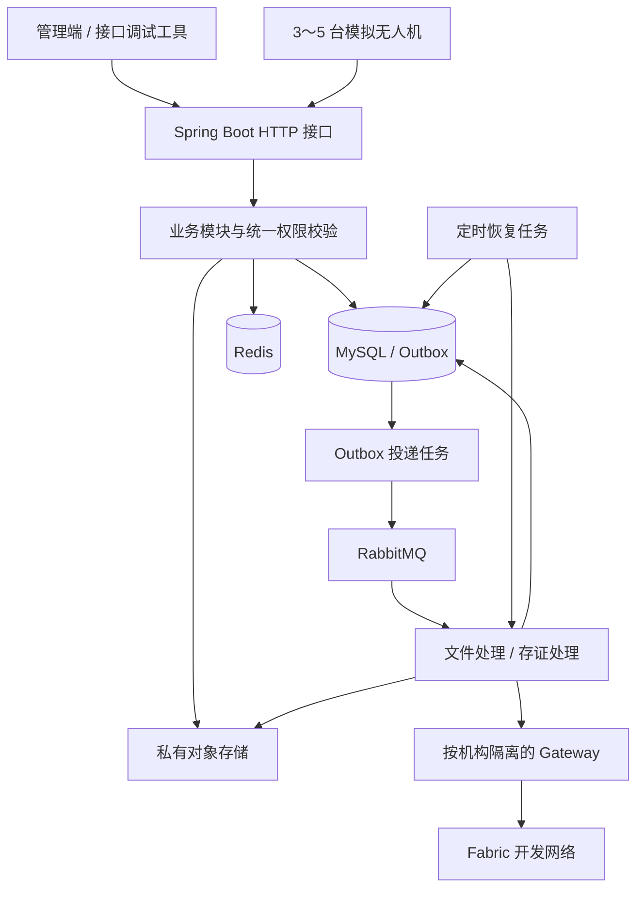
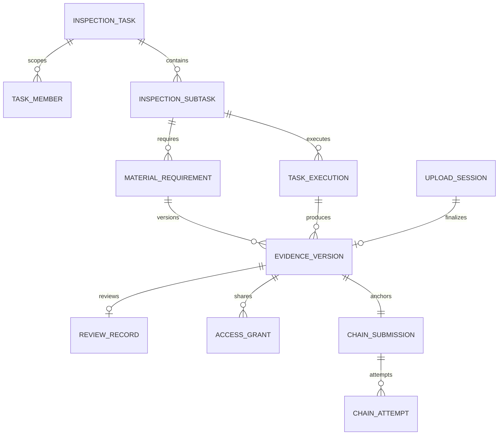

# 无人机集群巡检数据共享与证据溯源平台——技术设计

| 项目 | 内容 |
| --- | --- |
| 目标版本 | MVP（首版可演示版本） |
| 更新日期 | 2026-10-19 |
| 需求依据 | [01-requirements.md](01-requirements.md) |
| 架构 | Spring Boot 模块化单体，数据库作为业务状态的权威来源 |
| Fabric 范围 | 两个业务组织、一个通道、一份链码、两个业务操作 |

本文确定模块、数据模型、接口及关键处理规则，供后续建表和编码使用；示例目录与接口属于设计，不表示代码已实现。

## 1. 设计约束与技术选择

- Java 负责用户权限、任务、设备、文件、复核和共享；Fabric 仅登记和查询文件摘要。
- 文件在对象存储中保存，MySQL 保存业务记录，Redis 只保存可重建缓存。
- 同一工程包含 HTTP 接口、消息消费者和定时恢复任务，首版运行一个应用实例。
- 文件处理及链调用放在数据库事务之外；业务状态、待发送事件在本地事务中一起提交。
- 不引入微服务、分布式事务框架、MQTT、搜索引擎或额外工作流引擎。

| 项目 | 选型及约束 |
| --- | --- |
| 业务运行时 | JDK 21、Maven |
| Web 与认证 | Spring Boot 4.1.x、Spring Security，具体补丁版在工程初始化时固定 |
| 持久层 | MyBatis Spring Boot Starter 4.0.x、MySQL 8.4、Flyway 版本化迁移 |
| 缓存 | Redis，设备在线状态加速；不可作为唯一的业务持久化来源 |
| 文件 | S3 兼容私有对象存储，通过适配接口接入 |
| 消息 | RabbitMQ，持久化队列、持久化消息、发布确认及手动消费确认 |
| 区块链 | Fabric 2.5.x 开发网络、Fabric Gateway Java 稳定发行版、Java 链码 |
| 环境 | Docker Compose；Fabric 网络沿用官方测试网络的组织及排序服务结构 |

Spring Boot 的 Java 要求及 MyBatis Starter 的主版本组合分别参照[官方系统要求](https://docs.spring.io/spring-boot/system-requirements.html)和[兼容表](https://mybatis.org/spring-boot-starter/mybatis-spring-boot-autoconfigure/)。工程初始化时先完成启动和连接验证，再锁定具体依赖及镜像版本，不使用浮动 latest 或 SNAPSHOT 作为复现基线。

Fabric 镜像和二进制工具使用同一发行版本，samples 固定对应版本或提交。链码独立构建，使用匹配样例的 JDK 和构建配置，不假定其运行环境与业务服务相同。

## 2. 系统结构



业务包建议如下，包之间通过 Service 调用，不通过 HTTP 相互访问：

```text
backend/
  common/          异常、响应、分页、时间和请求标识
  identity/        登录、用户、角色、任务范围校验
  inspection/      总任务、子任务、资料要求、执行批次
  device/          设备认证、心跳、进度和模拟事件去重
  evidence/        上传、文件版本、存储适配和核验
  review/          异常、人工复核
  sharing/         申请、审批、授权和下载凭证
  blockchain/      Gateway 适配、存证记录和交易尝试
  messaging/       Outbox、消费者、投递及恢复
  audit/           操作记录和核验记录
chaincode/         独立 Java 链码工程
simulator/         模拟设备程序
deploy/            开发环境配置与脚本
```

## 3. 身份、权限与数据归属

### 3.1 平台身份

- 用户登录使用用户名、密码和 BCrypt 密码摘要；返回 30 分钟有效的 Bearer JWT，首版不实现刷新令牌。
- JWT 保存用户标识和 tokenVersion，不接受客户端指定机构或角色。每次请求读取数据库中的账号状态、机构、角色和 tokenVersion，停用、退出或角色变更后可使旧令牌失效。
- 预置两个机构、必要测试用户和角色；机构管理员只能管理本机构用户及适用角色，不能直接获得全部任务资料权限。
- 角色代码固定为 ORG_ADMIN、OWNER_TASK_ADMIN、OWNER_REVIEWER、OWNER_DATA_APPROVER、OPERATOR_TASK_ADMIN、OPERATOR_USER。获授权访问是资源授权，不是额外全局角色。

### 3.2 两条资源访问路径

1. **任务路径**：账号有效，机构是任务委托方或执行方，用户是该任务成员，并具备本次操作所需角色。
2. **共享路径**：账号有效，存在面向该用户、该文件版本、当前时间有效且未撤销的授权；只开放指定版本的查看、下载和核验，不开放整个任务及其他版本。

统一 ResourcePermissionService 执行以上判断。列表查询在 SQL 中按任务成员或授权过滤，分页前完成过滤；详情、预览、下载、核验再次检查同一规则。

创建任务时将创建人加入任务成员。委托方管理员指派本机构复核、审批成员，通过任务分配操作加入运营商任务管理员；运营商管理员可指派本机构操作人员，不能添加委托方成员或更改委托方验收要求。成员维护接口只替换调用者有权管理的本机构成员，必须保留其他机构成员和任务创建人，不能将 userIds 解释为整个任务的全量成员替换。

共享申请通过已知版本编号提交，不提供全平台证据搜索。未获授权者提交申请不会获得文件详情；对无效编号或不可申请资源返回统一错误，避免泄露任务信息。

### 3.3 设备身份

设备使用独立的随机设备令牌，数据库仅保存其摘要；设备标识与令牌一并校验。设备接口不接受用户 JWT 充当设备身份，也不允许设备调用复核、共享或用户管理接口。

每次模拟器启动生成 bootId，上报包含 eventId、seq、executionId。服务端以接收时间计算在线状态，以设备身份和执行批次校验上报范围。

### 3.4 Fabric 身份

| 业务机构 | 样例网络映射 | 应用能力 |
| --- | --- | --- |
| OrgA 委托方 | Org1MSP | 查询摘要 |
| OrgB 运营商 | Org2MSP | 登记和查询摘要 |

Gateway 按机构配置并复用连接，机构证书和私钥分别挂载。服务端先执行平台权限校验，再选择该用户所属机构的查询身份；后台自动登记统一使用 OrgB 身份。用户不能通过请求参数切换机构身份。

本地演示服务持有两个应用身份，属于开发部署的信任边界；不能据此声称两个机构已实现生产环境的运维隔离。平台个人操作写审计日志，链上体现机构应用提交。

## 4. 数据模型

### 4.1 通用约定

- 业务主键使用服务端生成的 UUID 字符串；证据编号独立于文件名和对象路径。
- MySQL 使用 InnoDB、utf8mb4；时间以 UTC 写入 DATETIME(3)，接口使用带 Z 的 ISO 8601，界面按 Asia/Shanghai 显示。
- SHA-256 使用 64 位小写十六进制字符串；文件长度用 BIGINT，业务版本号用正整数。
- 可变业务行包含 lock_version，用于条件更新；它与文件 version_no 含义不同。
- 外键及唯一约束在迁移脚本中定义，历史业务不级联删除；文件路径、对象键只由后端生成。
- 单项资料对应一个稳定证据编号。需要三张不同照片时配置三个资料项；同一资料项再次提交代表新版本，避免把补拍资料混成同一批文件。

### 4.2 用户与任务表

| 表 | 关键字段 | 约束或用途 |
| --- | --- | --- |
| organization | id、code、name、msp_id | code、msp_id 唯一，预置 OrgA/OrgB |
| app_user | id、org_id、username、password_hash、roles、enabled、token_version | username 唯一；roles 为固定枚举数组，不能自行创建角色 |
| inspection_task | id、owner_org_id、operator_org_id、name、scope、status、created_by、lock_version、completed_at | owner 固定为 OrgA，operator 固定为 OrgB |
| task_member | task_id、user_id | 联合唯一；业务层检查机构及角色 |
| inspection_subtask | id、task_id、name、current_execution_id、lock_version | 首次分配前 current_execution_id 可空，分配后指向本子任务当前批次 |
| material_requirement | id、evidence_id、task_id、subtask_id、name、required、next_version_no | evidence_id 唯一；启动前 subtask_id 可空，启动时必须绑定同任务子任务；next_version_no 在定版事务中递增 |
| drone | id、operator_org_id、code、token_hash、enabled、last_seen_at | code 唯一；归属 OrgB |
| task_execution | id、subtask_id、drone_id、status、started_at、closed_at、progress | 批次不可复用；状态 READY/RUNNING/CLOSED |
| device_event | id、drone_id、boot_id、seq、execution_id、event_type、received_at | 唯一 (drone_id, boot_id, seq)，防止重复计数 |

委托方创建草稿任务及必交要求；运营商在已分配阶段拆分子任务并绑定资料项。必交项的内容由委托方维护，运营商不能删除或降低要求。开始执行前检查所有资料项已绑定子任务，之后冻结资料要求，首版不提供执行中修改验收清单的流程。

### 4.3 文件、复核与共享表

| 表 | 关键字段 | 约束或用途 |
| --- | --- | --- |
| upload_session | id、task_id、requirement_id、execution_id、actor_type、actor_id、client_request_id、request_hash、filename、expected_size、part_size、part_count、status、expires_at、lease_token、lease_until、retry_count、next_action_at、last_error | 唯一 (actor_type, actor_id, client_request_id)，相同请求内容才可复用 |
| upload_part | session_id、part_no、size、sha256、object_key | 唯一 (session_id, part_no)，一个分片只接纳一种内容 |
| evidence_version | id、requirement_id、evidence_id、version_no、execution_id、upload_session_id、uploader_user_id、uploader_drone_id、submitter_org_id、object_key、size、sha256、review_status、created_at | 唯一 (evidence_id, version_no)、upload_session_id；出生即为校验完成的固定版本 |
| issue | id、task_id、evidence_version_id、description、created_by、created_at | 异常关联具体版本，不修改原文件 |
| review_record | id、evidence_version_id、decision、reason、reviewer_id、created_at | evidence_version_id 唯一；一版只形成一次正式复核结论 |
| access_grant | id、version_id、applicant_id、client_request_id、request_hash、status、reason、requested_valid_until、approver_id、valid_until、revoked_at、lock_version | 唯一 (applicant_id, client_request_id)；同键不同请求拒绝；一条记录承载申请与获批授权 |
| verification_record | id、version_id、user_id、source、actual_sha256、ledger_sha256、result、reason、verified_at | source 为 STORED/COPY；副本不产生证据版本 |
| audit_log | id、actor_type、actor_id、org_id、action、resource_type、resource_id、trace_id、result、created_at | 追加记录，不记录密码、令牌、私钥或完整下载地址 |

文件处理状态由 upload_session 表示；evidence_version 只保存已经就绪的版本，后文 READY 指这一就绪语义，不重复保存处理状态。review_status 初始为 PENDING；原始文件摘要、对象键和版本号不再修改。

当前验收版本采用数据库查询，首版不增加“最新版本指针”表：按资料项与子任务 current_execution_id 过滤，取最大 version_no。版本号按定版成功顺序分配，不使用设备时间或上传开始时间排序。

### 4.4 存证与消息表

| 表 | 关键字段 | 约束或用途 |
| --- | --- | --- |
| chain_submission | id、version_id、status、confirmed_tx_id、confirmed_by、retryable、retry_count、next_action_at、lease_token、lease_until、last_error | version_id 唯一；业务存证状态唯一来源 |
| chain_attempt | id、submission_id、attempt_no、tx_id、phase、transaction_bytes、commit_bytes、validation_code、created_at、updated_at | tx_id 唯一，(submission_id, attempt_no) 唯一；保留各次尝试 |
| outbox_event | event_id、event_type、biz_id、dispatch_no、payload、status、next_send_at、lease_token、lease_until、sent_at、last_error | event_id 主键；唯一 (event_type, biz_id, dispatch_no) |
| consumed_event | consumer_code、event_id、status、updated_at | 联合主键，状态 PROCESSING/DONE；与业务检查点一起提交 |

transaction_bytes 为背书后的可恢复交易数据，commit_bytes 为提交后取得的可恢复确认请求。二者均为受限访问的二进制字段，不经普通业务接口返回。

重点索引：task_member(user_id, task_id)、inspection_subtask(task_id)、material_requirement(task_id, subtask_id)、evidence_version(requirement_id, execution_id, version_no)、access_grant(applicant_id, version_id, status, valid_until)，以及存证、上传、Outbox 的 (status, next_action_at/next_send_at) 索引。



## 5. 状态与并发控制

### 5.1 状态映射

| 对象 | 枚举及转换 |
| --- | --- |
| 任务 | DRAFT → ASSIGNED → RUNNING → WAITING_ACCEPTANCE → COMPLETED；待验收时退回、新增当前版本或换机回到 RUNNING |
| 上传 | UPLOADING → VERIFYING → COMPLETED；确定处理错误转 FAILED，上传会话到期转 EXPIRED；临时故障保留 VERIFYING 并记录恢复计划 |
| 人工复核 | PENDING → APPROVED 或 RETURNED；同一版本不再次改判，补充资料创建新版本 |
| 存证 | PENDING → SUBMITTED → CONFIRMED；提交或查询结果不明转 UNKNOWN；明确拒绝或无效转 FAILED，符合条件时受控重试 |
| 共享 | PENDING → APPROVED 或 REJECTED；APPROVED → REVOKED；超过 valid_until 对外视为 EXPIRED |

授权到期判断始终按数据库时间执行，不依赖定时任务先更新 EXPIRED。CONFIRMED 不因后续查询失败而降级；本次核验仍可返回 CHAIN_QUERY_FAILED。

### 5.2 关键写入锁顺序

MySQL 业务事务使用 READ COMMITTED。影响任务验收的操作统一先锁 inspection_task，再依次锁子任务、资料项、文件版本及存证行；需要修改上传会话时在任务锁之后获取会话锁。不同入口遵守相同顺序。

需要协调的操作包括正式定版、换机、复核、确认存证、提交验收、确认完成。低并发首版使用数据库行锁及唯一约束，不以 Redis 分布式锁保证正确性。网络调用、文件读写不在这些锁内执行。

| 操作 | 事务内检查和更新 |
| --- | --- |
| 文件定版 | 任务未完成、会话仍归本处理租约；分配版本号，创建固定版本及存证任务；仅当前批次的新版本使待验收任务退回执行中 |
| 人工换机 | 任务未完成；关闭旧批次、建立新批次、切换 current_execution_id、记录调整；不改历史版本 |
| 人工复核 | 操作者有范围及角色权限，版本 PENDING；写一条结论并条件更新版本；当前批次最新版本被退回时待验收任务回到执行中 |
| 确认完成 | 状态为 WAITING_ACCEPTANCE；重新查全部当前批次必交项，各自最新版本均就绪、复核通过、存证确认 |

启动、提交验收和完成检查均要求至少一个子任务、每个子任务至少一个 required=true 资料项、全部子任务有当前执行批次，不能以空集合的“全部满足”通过校验。启动前还须确认所有资料项绑定本任务内子任务。

完成检查同时拒绝当前批次仍有 VERIFYING 上传的情况，防止已接纳的定版工作与验收交错。未提交完成的上传草稿不阻塞验收，但任务完成后不得继续生成正式版本。COMPLETED 为终态，禁止换机、资料定版和更改验收要求。

## 6. 关键处理流程

### 6.1 多机执行与离线补传

1. 委托方创建任务、指定运营商及成员；运营商绑定子任务、资料项和设备。首次分配设备时创建 READY 批次并更新 current_execution_id；启动任务时将这些批次转为 RUNNING、填写 started_at，不重复创建批次。执行中换机则直接创建新的 RUNNING 批次。
2. 模拟器每 5 秒通过 HTTP 上报心跳和进度。服务端认证设备，插入 device_event；唯一键冲突按重复事件返回，不重复处理。
3. 同一事务按当前批次更新进度、最近接收时间。进度在同一批次只递增，旧批次上报不推进当前进度。
4. 连续 20 秒无心跳显示离线；在线状态从最近服务端接收时间推导，Redis 失效后可查询数据库重建。
5. 人工换机生成新批次。旧设备可补传本来有权执行的旧批次资料，作为历史保存，不参与当前批次验收。

首版换机后，新批次重新提交该子任务全部必交资料，不实现跨批次自动合并验收。任务执行进度和成果验收进度分别显示，进度上报不能直接完成任务。

### 6.2 分片上传与文件定版

首版采用后端接收业务分片、对象存储保存分片的方案，不向客户端开放对象写入凭证。

1. 创建会话：校验任务、资料项、执行批次及上传者权限；固定文件名、长度、分片规格与关联信息。相同 clientRequestId、相同请求返回原会话，不同请求内容返回 409。
2. 上传分片：后端校验编号与预期长度，流式接收至临时文件并计算分片摘要，再上传到私有唯一对象键。短事务锁会话并插入分片记录；已有同编号同摘要返回原结果，不同内容拒绝覆盖。只有未过期的 UPLOADING 会话可增加分片，完成接口冻结后不再接纳新内容；并发失去写入资格的对象进入孤立对象回收。
3. 上传进度由数据库中的已完成分片返回，刷新页面或应用重启后可继续。不能只依赖客户端记录或 Redis。
4. 完成接口在短事务中检查分片连续、数量与总长度，冻结会话为 VERIFYING，写 FILE_FINALIZE_REQUESTED Outbox，返回 202。重复完成返回原会话进度或已生成版本。
5. 文件 Worker 领取带租约的会话，按序读取分片，重算各分片摘要并与记录比较，流式写入受限临时目录，同时计算完整 SHA-256 和长度；检查总长度及完整文件类型后，上传到独立最终对象键。SDK 上传重试不参与摘要计算，避免重复读取导致摘要错误。
6. 最终短事务重新检查任务状态和处理租约，锁资料项分配版本号，插入 evidence_version、chain_submission 和 EVIDENCE_ANCHOR_REQUESTED Outbox，更新会话为 COMPLETED，并记录审计。

最终对象键采用 evidence-files/{sessionId}/{processingToken}，每次处理尝试使用新 token，分片也使用唯一尝试键。数据库唯一 upload_session_id 决定只有一个正式版本；失去租约的 Worker 不得提交结果，产生的对象稍后回收。

文件已保存而数据库事务失败时，恢复程序检查是否已有该会话的正式版本：有则返回原结果；没有则重新领取并处理。清理只删除超过保留期、没有数据库引用且没有有效处理租约的临时或孤立对象，不删除正式版本。

### 6.3 人工复核与任务验收

- 文件就绪后即可由任务内复核人员处理，复核不等待链确认。
- 审核提交携带 expectedReviewStatus 或 lockVersion；数据库唯一结论和条件更新保证并发审核不会覆盖。
- 退回必须填写原因；操作人员提交新版本，旧结论保留。
- 提交验收要求每项必交资料已有当前批次就绪版本；复核或存证未完成时可进入待验收，但不能确认完成。
- 确认完成重新检查全部条件，按查询得到的实际版本决定结果，不采信页面进度、缓存计数或客户端传入的验收通过标记。

### 6.4 共享、撤销与下载

1. 申请人按指定版本提交申请，系统仅记录申请，不返回正文、文件名或对象地址。
2. 有任务范围权限的委托方审批人员检查版本 READY、复核 APPROVED、存证 CONFIRMED，并确定 valid_until；批准及审计在同一事务提交。
3. 新版本不继承授权，旧版本已有授权按原有效期或撤销状态继续执行。
4. 下载时走任务路径或共享路径重新鉴权。共享路径锁定授权行，签发有效期为 min(300 秒, 授权剩余时间) 的私有对象 GET 地址并写 URL_ISSUED 审计；剩余时间不足 1 秒时拒绝。
5. 任务路径的下载地址最长同样为 300 秒。任务成员资格或授权撤销后停止签发新地址，已签发地址可能使用至到期。

短期地址在服务端本地签名，返回内容包含 expiresAt，不在普通列表中缓存。签发成功不能记录为下载成功；首版不要求额外采集对象存储下载访问日志。

### 6.5 文件核验

用户指定有权访问的版本，选择核验已保存文件或上传副本。后端先鉴权，再流式计算实际字节摘要，使用用户所属机构 Gateway 查询登记记录，比较两个摘要；不以数据库保存的文件摘要代替本次计算。

副本只进入请求临时文件，不覆盖正式对象、不生成新版本、不触发存证。首版核验同步执行，并限制并发和处理时长；记录结果、具体原因及时间后清理临时文件。

| 结果代码 | 条件 |
| --- | --- |
| MATCH | 取得已登记记录且实际摘要相同 |
| MISMATCH | 取得已登记记录且实际摘要不同 |
| ANCHOR_UNCONFIRMED | 链查询成功但 found=false，当前无法取得该版本的有效登记记录 |
| FILE_READ_FAILED | 文件缺失、读取失败、核验输入损坏或文件处理超时 |
| CHAIN_QUERY_FAILED | 链查询失败、超时或登记响应不可解析 |

核验失败原因与内容不一致分别处理。本地状态仍待确认而链查询已取得有效记录时，可据实际摘要返回 MATCH/MISMATCH，本地存证状态由对账程序补齐；查询未发现记录不代表交易明确失败。副本太大或类型不允许属于输入错误，先拒绝请求。核验结果查询本身也需执行版本权限检查。

## 7. Fabric 合约与接入

### 7.1 开发网络

使用一个通道 mychannel、链码 evidence、合约 EvidenceContract；Org1MSP 对应 OrgA，Org2MSP 对应 OrgB。两个业务 Peer 各保存账本，排序服务沿用样例的独立排序组织，它不作为第三个业务参与方。

首版使用一个 Raft 排序节点及链码级静态背书策略 AND('Org1MSP.peer','Org2MSP.peer')，不增加状态级背书或多通道。节点背书表示认可一致执行结果，不代表委托方人员已人工复核。[官方测试网络结构](https://hyperledger-fabric.readthedocs.io/en/latest/test_network.html)

### 7.2 两个合约方法

| 方法 | 校验 | 结果 |
| --- | --- | --- |
| RegisterEvidence(evidenceId, version, fileHash) | 调用者 MSP 为 Org2MSP；编号格式有效、版本为正整数、摘要为 64 位小写十六进制 | 键不存在则创建；同摘要返回原记录；不同摘要返回 EVIDENCE_HASH_CONFLICT |
| QueryEvidence(evidenceId, version) | 调用者 MSP 为 Org1MSP 或 Org2MSP，参数格式有效 | 返回 found 与已登记记录；不存在返回 found=false，不假报已确认 |

账本键使用 evidence 类型的复合键及 evidenceId、version。记录包含 evidenceId、version、fileHash、submitterMsp、registeredTxId；重复登记返回首次记录，不改首次交易编号。

链码不访问 MySQL、对象存储或外部 HTTP，不读取系统时钟或生成随机业务编号。OrgA 尝试登记必须由链码拒绝，不能只靠 Java 接口限制。文件内容、任务关联、复核和权限均不上链。

### 7.3 接入接口

业务代码依赖 EvidenceLedgerClient，隔离 Fabric 具体调用：

```text
prepareRegistration(evidenceId, version, sha256) -> txId + transactionBytes
submitPrepared(transactionBytes) -> commitBytes
queryCommit(commitBytes) -> valid / invalid / unknown
queryEvidence(org, evidenceId, version) -> found + record
```

这些是 Java 内部适配方法，链上业务仍然只有两个。Gateway 提供拆分的背书、提交、提交状态确认流程，不能把异步提交返回当作有效提交。[官方 Gateway 流程](https://hyperledger-fabric.readthedocs.io/en/latest/gateway.html)

## 8. Outbox、交易确认与恢复

### 8.1 消息投递与消费

- Exchange 为 inspection.events，路由 file.finalize 与 evidence.anchor 分别进入两个持久化队列；消息只携带 eventId、eventType、bizId、traceId。
- 业务事务写 outbox_event。投递器领取待发送记录，开启 publisher confirm 与 mandatory 返回检查；只有可路由且发布确认成功后，才标记 SENT。
- 发布成功后应用崩溃可能重发，必须沿用原 eventId；新一轮人工重试增加 dispatch_no、生成新事件，不篡改历史。
- 消费者手动 ACK。业务租约防止并发处理，consumed_event 及业务唯一键负责消息重放判断；PROCESSING 不代表已完成，是否可以接管以关联上传或存证业务行的租约为准，不单凭消息时间判断。
- 仅在业务最终结果，或“等待状态、next_action_at 和后续恢复责任”持久化后，才将消费记录设为 DONE 并 ACK。不能先标记 DONE 再调用外部系统。
- 无法提交数据库检查点时不 ACK；参数错误等不可处理消息记录原因后进入死信队列，不能无限立即重入。

RabbitMQ 的发布确认与消费确认分别覆盖不同环节，二者都不能替代本地业务幂等。[官方确认机制说明](https://www.rabbitmq.com/docs/confirms)

### 8.2 存证处理顺序

1. 领取 chain_submission 的处理租约，若已 CONFIRMED 则直接结束重复事件。
2. 先查询相同证据编号和版本。若摘要相同，登记记录已存在，更新为 CONFIRMED，并保存记录中的首次 registeredTxId；摘要不同则 FAILED，禁止自动覆盖。
3. 对尚无登记记录的新任务，完成背书，取得 txId 和 transactionBytes，先写 chain_attempt，阶段 PREPARED。数据库提交成功后才允许调用提交操作。
4. 写 SUBMITTING 检查点后调用 submitAsync；取得返回后立即保存 commitBytes，并将业务状态置为 SUBMITTED。
5. 查询 commit 状态。有效提交后重新查询记录核对编号、版本和摘要，写 CONFIRMED；明确无效记录验证码，写 FAILED 并判断是否可重试。
6. 提交或确认 RPC 超时、响应丢失、进程退出时，不判断提交失败。写 UNKNOWN 和下一次查询时间；数据库无法写入时由已持久化尝试及租约恢复。

若已有未完成的 chain_attempt，执行第 8.3 节恢复流程，不因为一次业务查询返回不存在就重新准备交易。写 SUBMITTING 检查点及后续结果时必须校验处理租约；失去租约后不再发起新的提交操作。

transactionBytes 在提交前由 Transaction.getBytes() 保存，txId 用 getTransactionId() 取得；commitBytes 在 submitAsync 返回后保存，可用 Gateway.newCommit(bytes) 恢复确认查询。只有 txId 并不足以直接调用 newCommit。[Transaction API](https://hyperledger.github.io/fabric-gateway/main/api/java/org/hyperledger/fabric/client/Transaction.html)、[Gateway API](https://hyperledger.github.io/fabric-gateway/main/api/java/org/hyperledger/fabric/client/Gateway.html)

### 8.3 UNKNOWN 与失败重试

- 有 commitBytes 时先恢复原确认请求；同时以证据编号、版本查询已提交状态。同摘要登记可证明该业务版本已存在，保存账本记录的首次交易编号。
- 查询未发现记录不能证明原交易不会提交，也不能立即创建新 txId。
- 原提交可能未发送且没有 commitBytes 时，使用 OrgB 原身份和 transactionBytes，通过 Gateway.newTransaction(bytes) 恢复原交易并受控重发，保持原 txId；超时继续 UNKNOWN。
- 只有背书尚未进入提交、或原交易已明确无效且不存在同版本登记时，才按策略重新背书、创建新尝试；已确定的权限错误、摘要冲突不自动重试。
- 原交易重复提交可能出现重复交易验证结果，最终仍需查询业务键；已有同摘要有效记录时按已确认处理，保留各次尝试结果。
- UNKNOWN 不因超过次数或时长自动转 FAILED。页面显示等待时长与最近错误，允许运营商任务管理员发起“重新检查”，不允许用户强制标记成功或跳过原交易检查。

chain_attempt.phase 采用 PREPARED、SUBMITTING、SUBMITTED、VALID、INVALID、UNKNOWN，表达具体交易尝试；chain_submission.status 表达业务版本是否已存证，两者不混用。

每 10 秒扫描到期的 VERIFYING 上传及 PENDING/SUBMITTED/UNKNOWN、可重试 FAILED 存证，复用同一业务处理器及租约。扫描直接按业务行领取工作，不经过 consumed_event.DONE 的消息去重短路；DONE 只说明该条消息已完成处理或持久化移交，不代表业务一定已结束。首版以提交状态查询和定时对账作为恢复路径，不依赖链事件监听。

## 9. HTTP 接口草案

统一前缀 /api/v1。用户接口使用 Bearer JWT，设备接口使用设备令牌。常规 JSON 响应包含 code、message、data、traceId，列表返回 items、page、pageSize、total；pageSize 默认 20、最大 100。

创建上传会话和共享申请必须提供 clientRequestId。其他关键写入使用业务唯一键、状态前置条件及 expectedLockVersion；不把所有 POST 默认视为幂等。

### 9.1 用户、任务与设备

| 方法与路径 | 输入要点 | 权限及结果 |
| --- | --- | --- |
| POST /auth/login | username、password | 返回 accessToken、expiresAt |
| POST /auth/logout | 无 | 使当前用户旧 tokenVersion 失效 |
| GET /users/me | 无 | 当前账号、机构、角色 |
| PUT /users/{id}/roles | roles、expectedLockVersion | 本机构管理员，仅可分配本机构适用角色 |
| POST /tasks；GET /tasks | 名称、范围、资料要求；分页条件 | 委托方创建；列表按任务权限过滤 |
| GET /tasks/{id} | 无 | 任务成员；不因单个版本授权开放整个任务 |
| PUT /tasks/{id}/members | userIds、expectedLockVersion | 只更新调用者有权管理的本机构成员，保留其他机构成员及任务创建人 |
| POST /tasks/{id}/assign | operatorOrgId、operatorAdminId | 委托方任务管理员；进入 ASSIGNED |
| POST /tasks/{id}/subtasks | 名称、requirementIds | 分配阶段运营商管理员细化，不能删减必交要求 |
| POST /subtasks/{id}/executions | droneId、expectedLockVersion | 运营商管理员初次分配或人工换机 |
| POST /tasks/{id}/start | expectedLockVersion | 检查子任务、资料要求及设备完整，进入 RUNNING |
| POST /tasks/{id}/submit-acceptance | expectedLockVersion | 运营商提交，进入 WAITING_ACCEPTANCE |
| POST /tasks/{id}/complete | expectedLockVersion | 委托方检查全部验收条件，进入 COMPLETED |
| POST /drones；GET /drones | code；筛选条件 | 运营商管理员登记或按权限查看，首次返回设备令牌 |
| POST /device/reports | bootId、seq、eventId、executionId、type、progress | 设备身份；重复事件返回原处理结果 |

### 9.2 文件、复核、共享与存证

| 方法与路径 | 输入要点 | 权限及结果 |
| --- | --- | --- |
| POST /upload-sessions | clientRequestId、requirementId、executionId、filename、size | 操作员或设备，返回 uploadId、partSize、partCount、expiresAt |
| PUT /upload-sessions/{id}/parts/{partNo} | 分片二进制 | 校验会话归属和权限；同内容重复成功 |
| GET /upload-sessions/{id} | 无 | 进度、已完成分片、处理状态、versionId |
| POST /upload-sessions/{id}/complete | 无 | 冻结分片并异步处理，返回 202 或原结果 |
| GET /evidence-versions | taskId、requirementId、分页 | 仅返回可见版本的元数据 |
| GET /evidence-versions/{id} | 无 | 版本详情、复核及存证状态，不包含私有对象键 |
| POST /issues | versionId、description | 运营商任务成员提交异常 |
| POST /evidence-versions/{id}/review | decision、reason、expectedReviewStatus | 委托方复核成员，通过或退回 |
| POST /access-grants | clientRequestId、versionId、reason、requestedValidUntil | 注册用户申请，不返回文件详情 |
| POST /access-grants/{id}/decision | decision、validUntil、reason、expectedLockVersion | 委托方审批成员；检查正式共享条件 |
| POST /access-grants/{id}/revoke | reason、expectedLockVersion | 有权限的委托方审批人员 |
| GET /access-grants | mine 或 taskId、分页 | 申请人查看自身申请；审批人查看管理范围申请 |
| POST /evidence-versions/{id}/download-url | 无 | 当前权限校验后返回 url、expiresAt |
| POST /evidence-versions/{id}/verifications | source=STORED/COPY，COPY 附 multipart 文件 | 当前权限校验，返回核验记录及结果 |
| GET /evidence-versions/{id}/verifications | 分页 | 当前仍有版本权限才返回核验历史 |
| GET /evidence-versions/{id}/anchor | 无 | 存证状态、首次交易编号、最近失败原因 |
| POST /evidence-versions/{id}/anchor-retries | reason | OrgB 任务管理员受控重试或重新检查；不绕过未知态确认 |
| GET /tasks/{id}/audit-logs | 分页 | 有管理或复核权限的任务成员 |

任务及资料要求的草稿修改接口在实现时采用 PUT，并遵守草稿/已分配阶段及委托方权限约束；启动后不提供修改验收要求的入口。核心详情接口已覆盖复核历史、异常与版本关联展示。

### 9.3 响应与错误约定

```json
{
  "code": "OK",
  "message": "上传完成请求已接收",
  "data": {
    "uploadId": "示例会话编号",
    "processingStatus": "VERIFYING",
    "versionId": null
  },
  "traceId": "示例请求编号"
}
```

| HTTP 状态 | 含义及错误代码示例 |
| --- | --- |
| 200 / 201 | 查询、幂等返回或创建成功；核验 MISMATCH 仍为成功执行的业务结果 |
| 202 | 上传完成已接收，后台处理中；不宣称已存证 |
| 400 | 参数错误、分片不完整、文件类型不支持 |
| 401 | 未登录、用户令牌或设备凭证无效 |
| 403 / 404 | 无操作权限；不可见资源统一按 404 处理，不能泄露详情 |
| 409 | VERSION_CONFLICT、PART_CONTENT_CONFLICT、TASK_COMPLETED、TASK_NOT_ACCEPTABLE |
| 413 | FILE_TOO_LARGE 或分片超出配置 |
| 503 | 必需依赖不可用；核验已能形成明确不确定结果时返回结果代码及原因 |

## 10. 配置、部署与清理

以下为本地演示默认值，属于资源与交互限制，不代表压测结果：

| 配置 | 默认值及约束 |
| --- | --- |
| 上传允许类型 | jpg、jpeg、png、pdf、mp4；同时检查文件特征与声明类型，拒绝伪装或不支持类型 |
| 单文件大小 | 200 MiB，可配置；初期样例以小图片和 PDF 为主 |
| 业务分片大小 | 8 MiB，最后一个分片允许更小；服务端根据总长度计算分片规格 |
| 上传会话有效期 | 24 小时；VERIFYING 状态交由恢复任务，不能按上传过期直接清理 |
| 并发合并 / 核验 | 各 2 个；核验单次处理时限 60 秒，超时返回具体不确定原因 |
| 设备心跳 / 离线阈值 | 5 秒 / 20 秒，按服务端接收时间判断 |
| 下载地址有效期 | 最长 300 秒，并受共享授权剩余期限限制 |
| Outbox 扫描 / 恢复扫描 | 2 秒 / 10 秒 |
| 处理租约 / 续租 | 120 秒 / 30 秒；续租、检查点和结果提交均须匹配 lease_token 且 lease_until 大于数据库当前时间，过期后只能重新领取 |
| 重试 | 按 2、10、30、60、300 秒退避并封顶；明确可重试的失败存证自动最多 10 次后等待人工；上传 VERIFYING 的临时故障持续退避恢复，文件内容错误转 FAILED 后重新上传；UNKNOWN 持续对账，不按次数宣告失败 |
| Fabric RPC 时限 | 查询 5 秒、背书 15 秒、提交 10 秒、提交确认 30 秒；超时规则按第 8 节处理 |

开发环境包含 MySQL、Redis、对象存储、RabbitMQ、应用及 Fabric 网络；模拟器连接 HTTP 设备接口。配置区分应用访问地址与返回给浏览器的对象存储地址，不能把仅容器内可解析的地址签发给用户。

数据库、对象文件、消息及 Fabric 账本分别使用持久卷。应用重启不等于重建环境；不要将清空链网络作为日常启动步骤。数据库迁移、初始化账号、3～5 台设备及示例任务使用可重复执行的初始化过程。

私钥、密码和真实设备令牌由环境变量或本地挂载提供，不写入代码或日志；对象桶关闭公共访问，应用只按内部生成的键操作文件。

定时回收已过期上传分片和无引用处理对象，清理前重新检查数据库引用及有效租约。合并与核验临时文件在 finally 清理，启动时清扫失去租约的残留；处理前检查可用临时盘空间。

## 11. 验证与需求追踪

| 需求验收 | 设计落点 | 重点验证 |
| --- | --- | --- |
| AC-01 | 第 3、9 节 | 列表和直接按 ID 请求均不能越权；单版本授权不能访问整个任务 |
| AC-02 | 第 4、6.1 节 | 多设备并行、重复上报、缺失资料统计 |
| AC-03 | 第 5、6.1 节 | 换机与迟到上传并发，当前批次不被旧结果覆盖 |
| AC-04 | 第 6.2 节 | 应用重启后续传、重复分片、并发完成和事务失败后的孤立对象 |
| AC-05 | 第 5、6.3 节 | 复核并发只形成一条结论，新版本不继承通过状态 |
| AC-06 | 第 7、8 节 | OrgB 写入、OrgA 查询与拒绝写入；摘要一致幂等及冲突拒绝 |
| AC-07 | 第 6.5 节 | 实际重算文件摘要；修改副本一个字节得到 MISMATCH |
| AC-08 | 第 6.5、8 节 | 文件缺失和链查询失败分别返回，不能误判篡改 |
| AC-09 | 第 3、6.4 节 | 审批前后、授权到期、新旧版本权限独立 |
| AC-10 | 第 6.4 节 | 撤销后停止签发、地址期限上限、签发审计语义正确 |
| AC-11 | 第 6.2、8 节 | 发布确认后崩溃、RPC 前后崩溃、重复消息及 UNKNOWN 恢复 |
| AC-12 | 第 5 节 | 完成与新版本/换机/复核并发；必交项为空或未齐时拒绝完成 |

首个技术验证必须实际跑通两个组织的 Java 登记与查询；首个业务闭环实现一个任务、一个资料项、一个文件版本的上传、存证和核验。随后按需求补齐其余能力。

重点测试领域规则和跨系统失败恢复，不为简单字段映射堆叠测试。压测记录实际环境、文件大小、并发上传量、接口 P95、处理耗时和存证有效确认延迟，并区分 HTTP 接收成功与后台处理完成。

实现过程中若需更改本设计，应同步核对需求及验收条件；开发任务和完成进度由后续任务清单维护。
