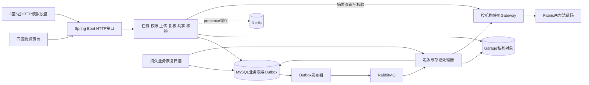

# T033 项目演示与讲解

本项目的讲解重心是Java后端如何管理多机任务、可靠上传、版本权限和跨系统恢复。Fabric提供固定版本摘要登记与查询，用来解释文件核验和交易结果不明时的处理。面试介绍、简历要点和追问答案见[面试材料](interview.md)。

本文整理一次完整演示及两个核心异常案例，引用T030～T032已经执行的记录。T033本轮只整理材料与核对证据，没有重新创建业务、提交链交易或进行性能测试。M5及完整MVP仍待T034最终核对。

## 1. 开场与业务主线

可以这样介绍：

> 这是一个面向园区委托方和无人机运营商的Java后端项目。委托方发布任务，运营商分配多台模拟设备，采集资料经过分片上传、固定版本、人工复核和授权共享。重点是上传幂等、资源权限、本地事务与消息一致性，以及服务崩溃后的恢复。Fabric只保存证据编号、版本和文件摘要等必要信息，原文件及业务数据保存在链外。

先讲清楚业务中的三个区别：

| 业务问题 | 本项目的处理 |
| --- | --- |
| 设备报到100%，是否完成任务？ | 进度与成果验收独立；仍需满足当前批次必交资料、最新版本复核和存证条件 |
| 上传返回202，是否已有可信成果？ | 202是异步接收；先等会话COMPLETED，再分别查看版本复核状态和链状态 |
| 给用户共享V1，是否也能读V2？ | 授权绑定固定versionId、用户和有效期；新版本不继承复核结论或授权 |

这些规则由后端实现，界面的按钮和提示只是辅助。

## 2. 架构与代码入口



这是模块化单体，业务模块在同一个Java应用内调用，不是微服务集群。开发环境有两个Peer、一个Orderer和两个CaaS实例；部署与拓扑见[设计](02-design.md)、[部署复现](deployment.md)。

| 讲解内容 | 实际代码入口 | 应说明的设计选择 |
| --- | --- | --- |
| 任务及换机 | [TaskService](../backend/src/main/java/com/uav/inspection/inspection/TaskService.java) | 任务、子任务、资料要求与执行批次分开；currentExecutionId决定当前成果归属，旧批次保留历史 |
| 身份与资源权限 | [ResourcePermissionService](../backend/src/main/java/com/uav/inspection/identity/ResourcePermissionService.java)、[AnchorQueryMapper](../backend/src/main/java/com/uav/inspection/blockchain/anchor/persistence/AnchorQueryMapper.java) | 当前账号、角色及任务成员或精确授权共同判断；SQL在COUNT/LIMIT前过滤 |
| 上传和定版 | [UploadTransactions](../backend/src/main/java/com/uav/inspection/evidence/upload/UploadTransactions.java)、[FinalizationProcessor](../backend/src/main/java/com/uav/inspection/evidence/finalization/FinalizationProcessor.java) | 请求号幂等、分片摘要、会话冻结、流式重算整文件、唯一约束及候选对象处理 |
| 消息与恢复 | [OutboxPublisher](../backend/src/main/java/com/uav/inspection/messaging/OutboxPublisher.java)、[FinalizationTransactions](../backend/src/main/java/com/uav/inspection/evidence/finalization/FinalizationTransactions.java) | 本地事务写派发意图、事务外I/O、重复消费防护、业务检查点及扫描补偿 |
| 存证状态 | [AnchorProcessor](../backend/src/main/java/com/uav/inspection/blockchain/anchor/AnchorProcessor.java)、[GatewayEvidenceLedgerClient](../backend/src/main/java/com/uav/inspection/blockchain/GatewayEvidenceLedgerClient.java) | 保存原交易/确认检查点；区分准备、提交、有效确认和UNKNOWN |
| 复核与共享 | [ReviewService](../backend/src/main/java/com/uav/inspection/review/ReviewService.java)、[DownloadService](../backend/src/main/java/com/uav/inspection/sharing/DownloadService.java) | 固定版本独立结论；签发前重鉴权、短时效及撤销窗口 |

Redis的lastSeen副本可丢失，在线判断仍以MySQL记录和服务端时间为准。当前实现读取设备仍查询SQL，不能把接入Redis描述成已经减少数据库查询或实现设备自动调度。

介绍Fabric时先把它理解成“由两个机构共同维护的固定版本摘要登记簿”：OrgB应用调用RegisterEvidence，OrgA/OrgB应用调用QueryEvidence。只有两个链码业务方法；最终用户登录身份与机构应用User1身份分开，权限、复核和共享依然由Java后端管理。

## 3. 演示准备与运行方式

### 3.1 环境与账号

首次部署遵循[README](../README.md#首次部署)，已有环境沿用原配置、凭据、证书和数据。使用JDK21，确认基础设施及Fabric已启动、应用和链码已构建。自动演示会独占启动自己的随机loopback端口后端；运行前停止普通项目后端、其他探针和消费者，并让已有在途业务收敛。

账号密码只从本机0600的`.local/demo-credentials.json`读取。演示职责如下，角色和成员条件仍由服务端检查：

| 身份 | 演示职责 |
| --- | --- |
| owner-admin | 建任务、分配运营商、维护委托方成员、正式完成 |
| operator-admin | 注册设备、建子任务/执行批次、人工换机、提交验收 |
| operator-user | 作为成员上传资料、执行核验 |
| owner-reviewer | 对每个固定版本独立复核 |
| owner-approver | 批准或撤销指定版本共享 |
| operator-outsider | 作为非成员验证授权前拒绝、V1/V2权限隔离及撤销 |

密码、Bearer JWT、设备令牌、私钥和签名下载地址不进入可提交示例、录屏或截图。页面切换账号会按正常退出规则影响令牌；自动脚本只登录、不退出原账号，浏览器演示与自动运行分开进行。

### 3.2 自动生成一组新成果

在所选项目根目录执行：

```bash
python3 deploy/scripts/deployment_demo.py
```

该入口实际启动`simulator/swarm.py`的三个worker，再沿正常接口完成四设备/三子任务、换机、四版本、独立复核、共享、核验和完成。每次普通运行会新建并保留一组任务/设备/文件及四条链登记；不是只读展示。模拟器的临时设备凭据配置为0600，结束删除，状态不含token。

成功指针是`.local/full-demo/latest.json`，对应目录中的resources.json给出本轮taskId、批次、versionId、授权和交易编号；report.json给出实际检查结果。不要把其他运行或另一套环境中的编号混进本次流程。

生成结束后，启动普通后端查看保留成果：

```bash
python3 deploy/scripts/run-backend.py --ledger
```

浏览器打开`http://127.0.0.1:8080/`，按本轮taskId筛选。自动流程已将任务正式完成，页面适合展示历史关系和结果；要现场逐步操作中间状态，应使用[连续HTTP模板](../examples/t029.http)另建任务，按下一节顺序推进，最后再完成。

### 3.3 查看既有成果

只读复查使用原运行目录；先停止前台应用，再将下面的runId替换为实际目录：

```bash
python3 deploy/scripts/run-demo.py --recheck .local/full-demo/<runId>
```

复查不新建任务、上传、复核、业务核验或登记，登录审计正常追加。授权按真实时间到期，历史APPROVED不代表永久有效。当前复查支持APPROVED/EXPIRED：到期后会检查非成员空列表及详情403，正常到期本身不会导致复查失败。若检查途中跨过到期边界，或授权被另行撤销/成员关系改变，则按真实状态判读；保留旧PASS，不强改授权或覆盖历史报告。

T032保留的一组完整成功证据在独立副本中：

```text
.local/deployment-repro/20261028T143649Z-8cd56664/workspace/
  .local/full-demo/20261028T143857Z-0e100632/
    report.json
    resources.json
    inspection.json
    simulator.log
    simulator-state/
    rechecks/20261028T144034Z-cbe2a83e/
```

这套副本最终已停止；恢复它需要先按[部署记录第6节](deployment.md#6-恢复本轮保留环境)在副本根启动依赖。主项目的full-demo/latest.json属于主项目，两套数据库和账本不同。不要用主项目后端查看副本UUID。

## 4. 约10分钟的完整讲解顺序

下表是建议讲解节奏，不是执行耗时测量。自动演示生成的历史可用于回看；现场手动操作通过[接口总目录](../examples/README.md)及[t029.http](../examples/t029.http)执行。每次写入使用最新锁号，资料和子任务按名称定位，不依赖响应数组顺序。

| 时间 | 展示内容与操作 | 应让面试官看到的结果 |
| --- | --- | --- |
| 0～1分钟 | 说明委托方与运营商；建三项必交资料任务并分配管理员/成员 | 任务归属、角色和成员是不同条件，同机构不自动全权 |
| 1～2分钟 | 注册四设备，分配三子任务，三机执行、一机备用，正式启动 | 每个子任务有独立当前执行批次，进度与缺失成果分别展示 |
| 2～3分钟 | 三设备报告；重复同一事件；人工换机后让旧设备向原批次迟到上报 | 原事件幂等；旧执行CLOSED，新执行有新ID，旧进度不污染当前批次 |
| 3～4分钟 | 上传一份资料，观察分片接纳、complete的202和后台状态 | 收齐分片/返回202不等于定版，更不等于复核或链上确认 |
| 4～5分钟 | 查看固定V1、CONFIRMED、复核APPROVED；向非成员精确共享V1 | evidenceId、versionNo、SHA及首次登记txId可关联；共享只开放这一版 |
| 5～6分钟 | 同资料提交不同内容形成V2；让非成员读V2和父任务 | V2重新PENDING，不继承V1复核；旧授权不能读V2或父任务，均受服务端限制 |
| 6～7分钟 | V2独立通过，另外两项资料各定版/复核/存证 | 共四个历史版本；当前三个必交成果满足条件，历史记录仍保留 |
| 7～8分钟 | STORED、原样COPY、变化COPY；签发并实际GET下载 | MATCH/MISMATCH来自实际字节；COPY不覆盖正式文件，签发与下载成功分开证明 |
| 8～9分钟 | 提交验收，委托方正式完成，再撤销V1并单独申请/批准V2 | COMPLETED写入时间；非成员最终只看当前有效授权版本，撤销阻止新签发 |
| 9～10分钟 | 展示审计/版本关系，选一个异常案例展开，再展示实测表 | trace、批次、版本、操作和交易可关联；按场景解释数据，而非堆检查次数 |

状态判读：上传COMPLETED、人工APPROVED、链CONFIRMED是独立维度；任务100%进度不替代验收条件。已完成任务不再新增正式成果或换机，历史仍可按权限读取。原样副本核验为MATCH，一字节变化副本可为MISMATCH；该变化副本只用于字节比较，不宣称仍是格式有效的PNG。

本轮完整演示的已执行依据来自T032：142次记录API、923项检查，另有真实三设备各2次、共6次HTTP上报及实际签名下载GET。四版均APPROVED/CONFIRMED，正式对象实读、双机构账本和原commit有效；新链位于块4～7。重启后30次API/217项只读复查通过。检查数、模拟器请求和单测数量分别记录，详情见[部署复现](deployment.md)。

## 5. 案例一：发布确认后崩溃

**可以这样描述问题：** 用户请求已经提交到MySQL，RabbitMQ也已经确认收到消息，但应用还没把Outbox改成SENT就退出了。重启后数据库只能看到SENDING，消息可能已被消费，再投递会重复，不投递又可能丢失工作。

处理链路如下：

1. [UploadCompletionService](../backend/src/main/java/com/uav/inspection/evidence/finalization/UploadCompletionService.java)在同一本地事务冻结会话为VERIFYING并写Outbox，保证“业务意图与待派发事件一起提交”。
2. 发布器以数据库租约领取事件，在事务外发送持久消息，检查publisher confirm及mandatory return，再按原token和未过期租约尝试写SENT。过期SENDING重新领取时保持eventId。
3. 消费端以`(consumer_code,event_id)`持久去重，业务行锁及唯一约束保护版本、会话和存证记录。正式版本、下一条Outbox、上传完成和消费检查点在短事务中提交。
4. [ManualMessageDelivery](../backend/src/main/java/com/uav/inspection/messaging/ManualMessageDelivery.java)在处理器返回且持久ACK条件通过后确认消息；有重试计划的业务由独立扫描继续处理。

这里需要说准确：publisher confirm证明broker接纳，不证明消费者已完成。消费DONE也不必等于业务成功；若已保存next_action_at并移交恢复责任、清空处理租约，可以ACK，业务扫描绕过DONE继续恢复。仅“其他worker忙”或“本worker租约失效”不足以ACK。

| 可核对证据 | 实际结果 |
| --- | --- |
| T030发布/候选崩溃组件 | `.local/publish-crash-probe/20261028T010847Z-35d4a8bf/verify.json`及report.json |
| 故障触发 | 独立JVM在真实发布确认后、SENT SQL前halt；不是抛一个可捕获异常 |
| 自然恢复 | 沿用120秒租约，实际等待剩余119823ms，没有SQL提前过期 |
| 重复投递 | 该原事件实际交付3次，其中一次是明确追加的post-DONE重放；eventId保持 |
| 业务结果 | 三个测试上传各一个正式版本、一个存证业务记录和一次有效链尝试，生产listener实际ACK |

源码继续看[OutboxTransactions](../backend/src/main/java/com/uav/inspection/messaging/OutboxTransactions.java)、[OutboxMapper](../backend/src/main/java/com/uav/inspection/messaging/persistence/OutboxMapper.java)、[FinalizationTransactions](../backend/src/main/java/com/uav/inspection/evidence/finalization/FinalizationTransactions.java)，故障装配见[PublishCrashRecoveryProbe](../backend/src/test/java/com/uav/inspection/messaging/probe/PublishCrashRecoveryProbe.java)。

面试结论是“允许至少一次投递，通过持久幂等与恢复让业务结果收敛”，不是跨MySQL、RabbitMQ和S3的严格exactly-once。单独使用本地事务、publisher confirm或手动ACK都不能代替整条处理链路。

## 6. 案例二：交易结果不明时恢复原交易

**可以这样描述问题：** 外部登记调用返回超时，交易可能已提交甚至有效，但应用尚未保存确认结果。把超时直接当失败、重新准备新交易，会丢失原交易责任并增加重复提交；查询暂时没记录也不能证明原交易失败。

应用将交易编排拆为短事务与外部I/O：Gateway准备/背书返回后，先保存PREPARED的原txId和交易检查点，再保存SUBMITTING意图；提交返回后保存commit检查点；取得真实有效回执及一致业务登记后再确认。原交易及确认字节保存在数据库内部BLOB检查点，不进入HTTP响应和公开报告；演示材料只显示状态、txId和摘要。

| 已知情况 | 当前实现的处理 |
| --- | --- |
| 已有commit检查点 | 优先查询原确认请求；不重新prepare，也不无条件重提交易 |
| 已有不确定的原交易、没有commit检查点 | 先查登记；一致则对账，仅查询成功且未命中时恢复原txId/transaction提交；查询不可用保留UNKNOWN，冲突保存明确错误 |
| commit和登记查询暂时不可用 | 保存UNKNOWN、next_action_at和退避，默认扫描继续；UNKNOWN不消耗明确冲突失败预算 |
| 已明确INVALID且是允许的并发冲突 | 只有MVCC_READ_CONFLICT/PHANTOM_READ_CONFLICT、业务键仍未命中、本轮预算未耗尽，才允许新attempt；每轮最多10次含首次 |
| 只有DUPLICATE_TXID或查询未命中 | 不据此另造交易；继续等待能够确认的原结果或登记 |
| 同证据/版本但摘要冲突 | 不覆盖既有登记；保留明确错误，人工重新检查也不能强改为成功 |

本地业务CONFIRMED与本地尝试VALID还要区分：崩溃导致commit检查点未保存时，可以凭真实不可变登记完成对账，首次registeredTxId取登记记录，可能与当前重复尝试txId不同。不能为了让状态好看而补造VALID或缺失字节。

| 可核对证据 | 实际结果 |
| --- | --- |
| T030 Fabric崩溃组件 | `.local/fabric-crash-probe/20261028T011136Z-47d9a177/verify.json`及report.json |
| 三个真实窗口 | submit前、submit返回后/commit检查点前、commit确认返回后/业务落库前退出 |
| 恢复行为 | 自然等待剩余115689ms；recoveryPreparedTransactions=0，只有before-submit场景重提原txId |
| UNKNOWN持久化 | 对commit及业务回退查询各注入2次UNAVAILABLE，观察到retry_count=2、next_action_at及原消费DONE；放开后收敛 |
| 原检查点 | 三项各保留一个原attempt；原交易及已有commit字节摘要保持 |
| 重要例外 | after-submit项业务CONFIRMED，但原尝试合法保留SUBMITTING，commitBytes及本地validationCode/block仍空；探针保留崩溃前真实VALID依据与双方查询，没有伪造本地VALID |

源码看[AnchorProcessor](../backend/src/main/java/com/uav/inspection/blockchain/anchor/AnchorProcessor.java)、[AnchorTransactions](../backend/src/main/java/com/uav/inspection/blockchain/anchor/AnchorTransactions.java)、[AnchorRetryService](../backend/src/main/java/com/uav/inspection/blockchain/anchor/AnchorRetryService.java)及[FabricCrashRecoveryProbe](../backend/src/test/java/com/uav/inspection/messaging/probe/FabricCrashRecoveryProbe.java)。Gateway SDK提供prepare/submit/queryCommit等能力，应用自己实现持久状态、恢复顺序、重试资格和权限。

两个案例中的文件定版/存证处理使用120秒租约、30秒续租及数据库UTC/token条件更新，防止失权worker提交业务结果。Outbox发送租约也为120秒，publisher confirm最长等待10秒，但发送租约没有这套30秒续租。阻塞的S3/Gateway调用未必能立即取消，返回后仍需检查；租约不撤回已经发生的外部副作用。UNAVAILABLE注入发生在测试适配边界，没有物理停止共享Fabric网络。故障复跑入口与隔离规则见[T030验收](t030-acceptance.md)，现场讲解可以直接使用既有证据和源码。

## 7. 实测指标的讲法

T031使用与T030相同生产产物，在单机开发环境测量。主机8个可见逻辑CPU、约15.57GiB内存，客户端、后端及依赖共宿主；查询使用一个任务/预热版本的小数据集。每档约10秒闭环，并发是活跃worker数。P95为nearest-rank，错误和预热分别记录。

| 可用于说明的结果 | 条件与正确解释 |
| --- | --- |
| 任务进度P95 26.88ms，0错误 | 并发5、2293次请求；不是生产最大QPS或全接口P95 |
| 五设备上报P95 66.49ms，0错误 | 5 active、891次正式请求，无pacing；配置设备数和在线缓存数另计 |
| 17MiB×5，每文件3片；202 P50/P95 70.83/80.84ms | 这是接收耗时，不是文件处理或链确认耗时 |
| 同组创建至确认观测P50/P95 10.066/14.224s | 含上传、排队、处理、落库和250ms轮询；n=5，P95等于最大值，不是纯Fabric commit |
| 正式文件PREPARED检查点至VALID落库2035～2059ms | 数据库UTC内区间；包含提交/查询/持久化，前置背书不在该区间 |
| 517后端、50链码测试；12项AC通过 | 单测、AC门槛、脚本步骤、HTTP数及断言数分别统计，不能混成同一种测试量 |

整体30343查询、1756正式上报、11正式文件全成功，另1预热文件，共12版本真实VALID；这12项正常测量与案例二的恢复例外不是同一组记录。后端正式阶段观测RSS峰678.6MiB，进程CPU按单核100%，采样成本未扣除。所有条件及原始入口见[性能记录](performance.md)，不推导链TPS、生产SLA或无对照的提升百分比。

17MiB样例是在合法16×16 PNG中加入合法tEXt块，覆盖传输、CRC、合并及存储，不能代表高分辨率图像解码。开发配置的Outbox扫描1000ms、定版/存证各1个实际消费者prefetch=1、Hikari最大5均未为成绩调优。

## 8. 收尾与自查

讲解结束时用一句业务结论收尾：“我把文件版本、访问权限和异步处理责任保存下来，让多次请求、消息重复和进程退出之后，系统仍能给出可解释的业务结果。”随后按追问展开[面试材料](interview.md)。

演示前确认本轮环境及资源清单、Java21、角色/成员和授权有效期；准备一条正常链路、以上两个异常证据和带条件的指标。复核角色是某版本的业务判断，摘要一致不证明现场、时间或位置真实；机构User1代表机构应用，个人操作依靠链外审计关联。链外任务、权限、复核和审计并未逐项上链。

本轮文档核对覆盖源码入口、相对链接、T030异常证据、T031指标及T032完整演示；没有新跑服务、重签授权或修改保留成果。下一项T034进行最终交付核对，不能仅因本页写完就宣布完整MVP结束。
